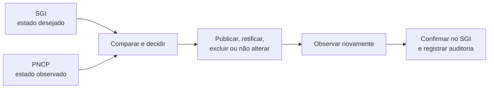

# PCA/PNCP

**Classificação documental:** Autoritativo

**Status:** Vigente

**Autoridade/Escopo:** visão geral, finalidade do produto, primeiros passos e
rota inicial de leitura; não substitui as fontes especializadas.

Este projeto é uma solução para publicar e manter o Plano de Contratações Anual (PCA) do SGI
alinhado ao PNCP, com segurança e rastreabilidade.

O sistema transforma os Planos homologados no SGI na fotografia que deve existir
no Portal Nacional de Contratações Públicas (PNCP), compara esse estado desejado
com o que está efetivamente publicado e conduz as alterações necessárias. Uma
operação só é considerada concluída depois que o resultado externo é novamente
observado e a convergência é comprovada.

## Por que este projeto existe

Publicar um PCA não se resume a enviar dados para uma API. O SGI e o PNCP são
sistemas independentes: uma alteração confirmada em um deles não é desfeita
automaticamente no outro, e falhas de rede podem tornar incerto o resultado de
uma escrita.

O projeto concentra esse processo em um fluxo explícito e testável, capaz de:

- reconstruir a fotografia vigente a partir dos Planos e Demandas do SGI;
- operar por Unidade Orçamentária ou de forma consolidada;
- decidir entre `PUBLICAR`, `RETIFICAR`, `EXCLUIR_PCA` e `NENHUMA_ACAO`;
- executar alterações no PNCP sem repetir escritas incertas às cegas;
- observar novamente o estado externo antes de confirmar a operação no SGI;
- preservar confirmações, auditoria de negócio, eventos técnicos e correlação;
- conter falhas por unidade e apresentar resultados seguros ao operador.

## Como funciona



O SGI determina o que deveria estar publicado. O PNCP fornece o estado externo
observado. O backend coordena a convergência entre esses dois estados e trata
explicitamente conflitos, concorrência, rejeições e resultados incertos.

## Estado do produto

O sistema está construído, integrado à aplicação Blank do Scriptcase, empacotado
como release autocontida e instalado em produção. A condição do produto, as
restrições externas e as ações seguras para manutenção e suporte ficam
centralizadas na
[situação operacional](docs/vigentes/operacional/situacao_operacional.md).

Esse documento operacional deve ser consultado antes de qualquer execução real.
Uma pendência externa não autoriza repetir uma escrita, avançar uma etapa ou
inferir que uma operação anterior não produziu efeito.

## Arquitetura

O projeto adota:

- PHP 8.1,
- Domain-Driven Design,
- Clean Architecture,
- SOLID,
- injeção de dependências,
- PSR-4, PSR-12, PSR-3 e
- desenvolvimento orientado por testes (TDD).

```text
Scriptcase -> fachada pública -> Presentation -> Application -> Domain

Infrastructure --implementa--> Ports definidas nas camadas internas
```

- **Domain** representa conceitos, invariantes e decisões do negócio;
- **Application** coordena o caso de uso e as fronteiras transacionais;
- **Infrastructure** se comunica com o mundo físico: implementa Oracle, PNCP, configuração e observabilidade;
- **Presentation** adapta a entrada e produz uma saída segura;
- **Composition Root** monta um grafo novo de dependências para cada execução;
- **Scriptcase** conhece apenas o autoloader e as fachadas públicas.

O desenho completo está no
[guia de arquitetura](docs/vigentes/apoio/arquitetura.md). Para acompanhar uma
execução pelas classes reais, use o
[guia de leitura do código](docs/vigentes/apoio/guia_de_leitura_do_codigo.md).

## Tecnologias e integrações

- PHP `^8.1` e Composer;
- PHPUnit `^10`;
- Oracle 19c por conexão ADOdb emprestada pelo Scriptcase;
- API do PNCP por HTTPS/cURL;
- aplicação Blank do Scriptcase como sistema hospedeiro;
- pacote autocontido com manifesto de integridade.

## Como começar

Pré-requisitos para desenvolvimento:

- PHP 8.1 ou versão compatível com a restrição do projeto;
- Composer;
- extensões requeridas pelas dependências instaladas.

Instale as dependências:

```bash
composer install
```

Execute a suíte padrão:

```bash
composer tests
```

A suíte padrão não acessa Oracle, PNCP ou Scriptcase reais. Contratos, probes,
preflights e operações de pacote possuem comandos separados e podem exigir
configuração, ambiente e autorização específicos. Consulte o
[catálogo de comandos Composer](docs/vigentes/apoio/catalogo_de_comandos_composer.md)
antes de executar qualquer outro comando.

## Documentação e ajuda

| Necessidade | Ponto de entrada |
| --- | --- |
| Entender a organização, a autoridade e a ordem da documentação | [Índice documental](docs/README.md) |
| Consultar a condição do produto e as restrições correntes | [Situação operacional](docs/vigentes/operacional/situacao_operacional.md) |
| Localizar conceitos e classes no fluxo | [Guia de leitura do código](docs/vigentes/apoio/guia_de_leitura_do_codigo.md) |
| Identificar a função de um arquivo | [Catálogo de arquivos](docs/vigentes/apoio/catalogo_de_arquivos.md) |
| Interpretar uma resposta ou diagnosticar uma falha | [Guia operacional de diagnóstico](docs/vigentes/operacional/guia_operacional_de_diagnostico_da_publicacao_pca.md) |
| Implantar, atualizar ou reverter uma release | [Guia de implantação e rollback](docs/vigentes/operacional/guia_de_implantacao_e_rollback.md) |
| Contribuir ou atuar como agente | [`AGENTS.md`](AGENTS.md) e [governança de agentes](.agents/README.md) |

As regras de negócio, o modelo de domínio e as decisões de integração pertencem
às fontes autoritativas indicadas no índice documental. Investigações,
documentos históricos e artefatos de agentes não substituem essas fontes.

## Finalidade didática

Além de entregar a integração PCA/PNCP, o projeto registra a aplicação prática
de DDD, Clean Architecture, SOLID, Design Patterns, TDD e desenvolvimento
orientado por especificações (SDD). Esses recursos são empregados para tornar regras,
fronteiras e riscos compreensíveis, testáveis e reversíveis — não como objetivos
isolados.

As explicações destinadas a contribuidores devem apresentar o problema, a
solução, o conceito aplicado e o motivo de cada responsabilidade pertencer à
camada escolhida. Separadas em:

- docs/README.md: ponto de entrada para compreender o sistema e localizar suas fontes;
- AGENTS.md: instruções permanentes para implementar, validar e comunicar alterações;
- .agents/: planejamento e continuidade do trabalho dos agentes.