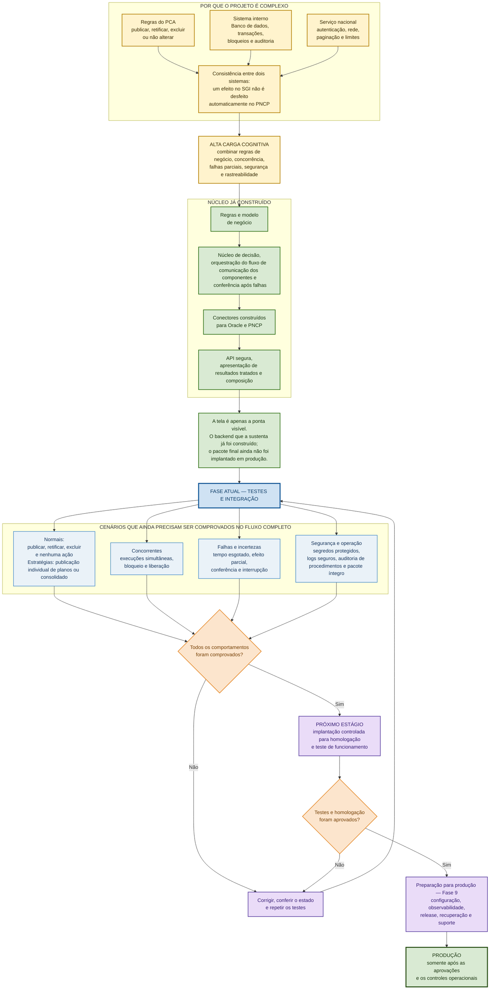
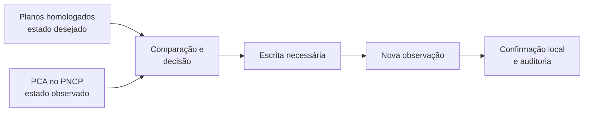
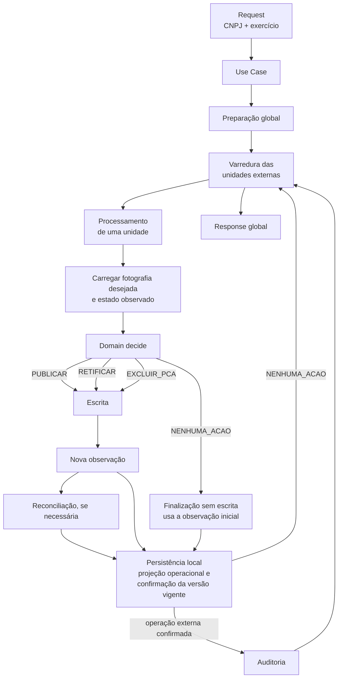
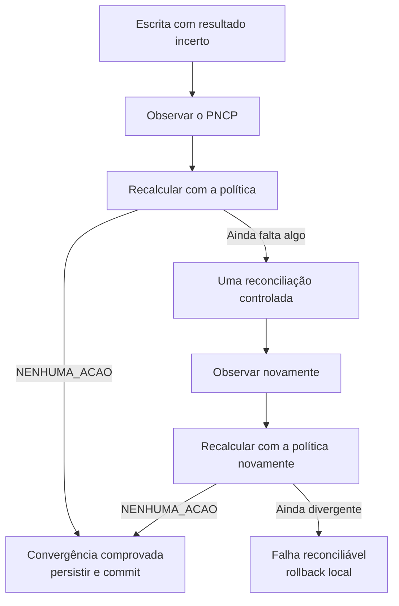
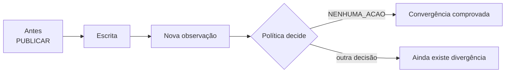
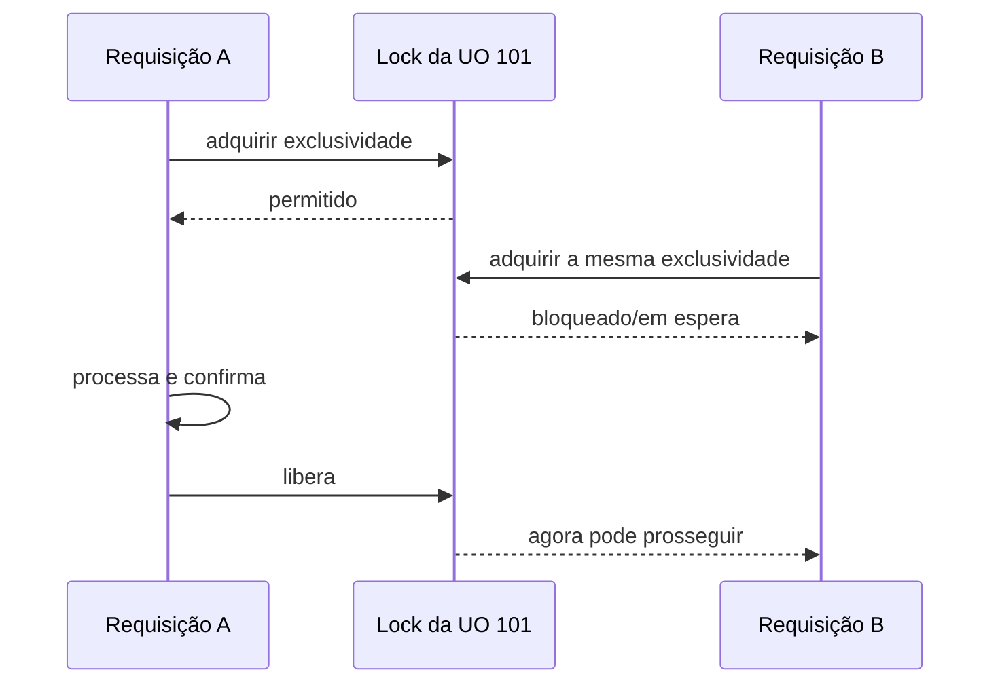
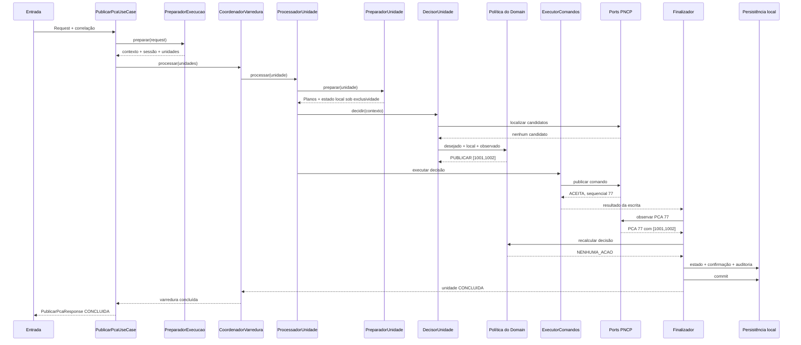

# Visão do projeto PCA-PNCP-BACKEND

**Classificação documental:** Apoio  
**Status:** Vigente  
**Referência temporal:** estado operacional atualizado em 02/09/2026

Este diagrama resume o estado corrente sem substituir o [estado operacional](../vigentes/operacional/estado_atual.md) nem a ordem de
construção definida pelo [Roadmap](../vigentes/autoritativos/roadmap.md).

> Foi empregado tempo considerável na construção e na proteção do núcleo que coordena dois sistemas com comportamentos diferentes. O projeto está comprovando, de forma controlada, que o núcleo já implementado é seguro para avançar até homologação e, somente depois das aprovações e da preparação operacional, até produção.

# É um processo de sincronização:

> A nova observação é importante porque uma resposta técnica de sucesso não prova, sozinha, que o estado externo ficou correto. O objetivo real é alcançar convergência: 
> estado observado no PNCP = estado desejado pelo sistema

# O fluxo geral

## Cenário de escrita incerta

# A prova de convergência

>Depois da operação, a política passa a dizer que nenhuma alteração é necessária.

# A solução para lidar com o problema da concorrência: lock

# 1. O mapa completo da chamada

