# Guia histórico de compreensão do backend

**Classificação documental:** Histórico

**Autoridade/Escopo:** investigação didática do projeto em uma etapa
anterior da construção, logo após a implementação da camada Application, Fase 4 do Roadmap.

> Cuidado! Este documento histórico não descreve necessariamente o sistema completo atual. Ele foi preservado pelo valor didático. Seus caminhos e sua visão arquitetural refletem o momento da investigação e devem ser confrontados com a documentação vigente antes de orientar manutenção.

# Índice

1. Produto e camadas
2. Domain
3. Application
4. Falhas e transações
5. Testes e Infrastructure
6. Explicação em cinco minutos

# Etapa 1 — Visão geral do produto e das camadas
Nesta etapa, olharemos o backend “de helicóptero”. Alguns componentes internos ficarão deliberadamente como caixas-pretas até as próximas etapas.

<br>

---

## 1. Qual problema este backend resolve?

O backend mantém o PCA publicado no PNCP coerente com os planos homologados no sistema de origem. Ele recebe essencialmente:

* um CNPJ;
* um exercício;
* uma correlação para rastrear a execução.

A partir daí, precisa responder: 
> “Qual deveria ser a fotografia pública do PCA para cada unidade e o estado observado no PNCP já corresponde a essa fotografia?”

Se não corresponde, o sistema decide e executa uma destas ações:

* publicar;
* retificar;
* excluir o PCA;
* não fazer nada.

Portanto, ele não é simplesmente um serviço que faz um POST no PNCP. É um processo de sincronização:
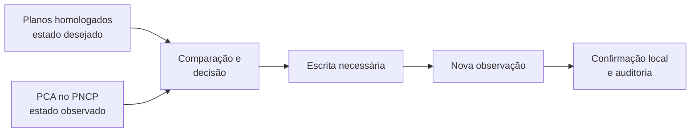
A nova observação é importante porque uma resposta técnica de sucesso não prova, sozinha, que o estado externo ficou correto. O objetivo real é alcançar convergência: 
> estado observado no PNCP = estado desejado pelo sistema

O processamento pode tratar unidades individualmente ou reuni-las em uma unidade externa consolidada. Isso altera a formação das unidades processadas, mas não muda a ideia central.

<br>

---

## 2. As camadas

### Domain: sabe o que deveria acontecer. Ele contém:

* os conceitos do negócio, como Plano e Demanda;
* Value Objects, como CNPJ e exercício;
* invariantes;
* a política que compara o desejado com o observado;
* as decisões PUBLICAR, RETIFICAR, EXCLUIR_PCA e NENHUMA_ACAO.

Ele não sabe:

* abrir transações;
* consultar Oracle;
* autenticar no PNCP;
* enviar requisições HTTP;
* gravar logs técnicos;
* percorrer unidades.

Então a pergunta é:
> “Diante destes fatos, qual é a decisão correta segundo o negócio?”

Uma classe central é a [PoliticaProcessamentoPlano.php](../../../backend/src/Domain/Policies/PoliticaProcessamentoPlano.php).

1. Problema: decidir o que deve acontecer com o PCA.
2. Quem chama: a etapa decisória da Application.
3. Quem ela chama: apenas objetos e regras do próprio Domain.
4. O que recebe: planos, estado operacional local e PCA observado.
5. O que devolve: uma decisão de negócio tipada.
6. Onde aparece: depois da leitura dos dados e antes de qualquer escrita.
7. Por que está no Domain: a resposta deve continuar igual mesmo se Oracle, PNCP ou framework forem substituídos.

A política decide. Ela não executa a decisão.

---

### Application: conduz o processo

A Application é a coordenadora. Ela sabe:

* em que ordem consultar as informações;
* quando iniciar e encerrar transações;
* quando pedir uma decisão ao Domain;
* quando executar a escrita correspondente;
* quando observar novamente o PNCP;
* quando persistir e auditar;
* como interromper o fluxo com segurança.

Ela não deveria conter regras de integração específicas, como endpoints, SQL ou detalhes do Scriptcase.

Em uma frase:
> O Domain determina a ação correta; a Application cria as condições, solicita a decisão e conduz sua execução com segurança.

---

### Ports: descrevem capacidades necessárias

Uma Port é uma interface pela qual a Application declara:

> “Para realizar este fluxo, preciso que alguém seja capaz de fazer isto.”

Exemplos conceituais:

* buscar planos homologados;
* abrir, confirmar ou reverter uma unidade de trabalho;
* autenticar no PNCP;
* observar o PCA;
* publicar ou retificar itens;
* persistir o resultado;
* registrar auditoria.

A Port não diz se isso será feito com:

* PDO;
* Oracle;
* cURL;
* uma biblioteca HTTP;
* Scriptcase;
* um serviço remoto.

Esse detalhe pertence à Infrastructure.
Ports não são uma “quinta camada de negócio”. Elas são os contratos que protegem Application e Domain dos detalhes tecnológicos.

---

### Infrastructure futura: realiza tecnicamente as capacidades

Na Fase 5, a Infrastructure fornecerá adapters concretos para as Ports.
Por exemplo:

Application precisa observar o PCA
              │
              ▼
       Port de observação
              ▲
              │ implementa
      Adapter HTTP do PNCP

É útil separar dois tipos de direção:
* Fluxo em execução: a Application chama uma Port e o adapter executa o trabalho.
* Dependência do código: o adapter depende do contrato interno; a Application não depende da classe concreta do adapter.

Isso é **inversão de dependência**. A regra interna não fica acoplada à tecnologia externa.

Ao entrar na Fase 5, a ideia é trocar doubles por adapters, sem reescrever a decisão do Domain nem o fluxo principal da Application.

## 3. O fluxo geral
Este é o mapa principal que orientará as próximas etapas:

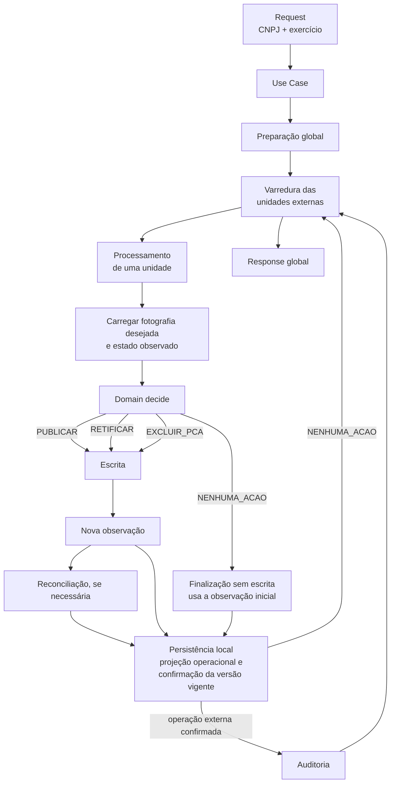

Em linguagem direta:

1. O Request entrega CNPJ e exercício já validados e tipados.
2. O Use Case inicia a execução e preserva sua identificação de correlação.
3. A preparação global resolve o usuário, a estratégia anual, as unidades externas e a sessão PNCP compartilhada.
4. O coordenador percorre cada unidade externa — uma UO no modo individual ou a união das UOs no consolidado.
5. Cada unidade é aberta sob exclusividade, usando a mesma conexão e transação Oracle.
6. A Application reconstrói a fotografia vigente, lê o estado operacional local e observa o PCA correspondente no PNCP.
7. O Domain compara a fotografia desejada com o estado externo observado e escolhe PUBLICAR, RETIFICAR, EXCLUIR_PCA ou NENHUMA_ACAO.
8. Quando a decisão exige alteração externa, a Application envia o comando tipado ao PNCP por meio das Ports.
9. Depois da escrita, o PNCP é observado novamente. Em NENHUMA_ACAO, a observação inicial já válida é reutilizada.
10. Se necessário, a Application realiza uma reconciliação adicional somente por leitura, sem repetir uma escrita incerta.
11. Somente após comprovar a convergência, o backend persiste o estado operacional — estratégia, UASG, estado e sequencial — em todas as versões físicas do escopo, completando eventuais projeções pendentes.
12. As confirmações anteriores são preservadas. Somente a versão vigente ainda pendente de cada UO processada recebe a confirmação de sincronização; versões intermediárias permanecem sem confirmação.
13. Uma auditoria é registrada apenas quando uma operação externa de publicação, retificação ou exclusão integral foi efetivamente concluída e confirmada. NENHUMA_ACAO não cria auditoria.
14. Projeção operacional, confirmação versionada e auditoria aplicável são concluídas na mesma transação Oracle. Qualquer falha impede o sucesso e aciona o rollback da unidade.
15. O coordenador preserva o resultado da unidade, decide se pode continuar e, ao final, o Use Case monta a Response global.

## 4. As classes mínimas para navegar nesse mapa

> PublicarPcaRequest

Arquivo: [PublicarPcaRequest.php](../../../backend/src/Application/UseCases/PublicarPca/PublicarPcaRequest.php)

1. Problema: transportar a entrada válida do caso de uso.
2. Quem chama: futuramente, a camada de entrada do Scriptcase; hoje, principalmente os testes.
3. Quem ela chama: ninguém.
4. O que recebe: Cnpj e AnoExecucao.
5. O que devolve: permite ao Use Case recuperar esses dois valores.
6. Onde aparece: no início do fluxo.
7. Por que está na Application: representa a entrada de um caso de uso, não uma entidade de negócio nem um formato HTTP.

Um detalhe importante: ela não recebe duas strings soltas. Recebe Value Objects já válidos. Assim, o fluxo não começa carregando valores semanticamente inválidos.

> PublicarPcaUseCase

Arquivo: [PublicarPcaUseCase.php](../../../backend/src/Application/UseCases/PublicarPca/PublicarPcaUseCase.php)

1. Problema: representar a operação completa “publicar/sincronizar PCA”.
2. Quem chama: a futura camada de entrada e os testes.
3. Quem ele chama: o preparador global e o coordenador da varredura.
4. O que recebe: PublicarPcaRequest e a correlação da execução.
5. O que devolve: PublicarPcaResponse.
6. Onde aparece: é a porta de entrada principal da Application.
7. Por que está na Application: ele coordena um caso de uso; não formula a decisão de negócio nem implementa Oracle ou PNCP.

Ele funciona como o diretor da operação. Não executa pessoalmente todas as tarefas.

> PreparadorExecucaoPublicacaoPca

1. Problema: realizar uma única vez tudo que deve preceder a varredura.
2. Quem chama: PublicarPcaUseCase.
3. Quem ele chama: Ports relacionadas a usuário, planos, estratégia anual, unidade de trabalho e autenticação.
4. O que recebe: os dados globais da execução.
5. O que devolve: o contexto preparado, a sessão e as unidades externas a visitar — ou uma falha segura.
6. Onde aparece: entre o Use Case e a varredura.
7. Por que está na Application: autenticação, transação e ordenação de consultas são coordenação; não são decisão pura do Domain nem detalhes concretos dos adapters.

Ele evita repetir trabalho global para cada unidade. É aqui, por exemplo, que a execução determina quais unidades serão processadas e obtém uma sessão utilizável no PNCP.

> CoordenadorVarreduraUnidades

1. Problema: percorrer as unidades externas sem perder o controle global da execução.
2. Quem chama: PublicarPcaUseCase.
3. Quem ele chama: o processador de uma unidade.
4. O que recebe: contexto do usuário, sessão, CNPJ e unidades planejadas.
5. O que devolve: o resultado da varredura, com resultados e contagens.
6. Onde aparece: depois da preparação global.
7. Por que está na Application: percorrer, acumular resultados e interromper com segurança são responsabilidades de orquestração.

Pense nele como um laço controlado:
para cada unidade externa:
    processar unidade
    guardar resultado
    avaliar se a varredura pode continuar

> ProcessadorUnidadeInterno

Arquivo: [ProcessadorUnidadeInterno.php](../../../backend/src/Application/UseCases/PublicarPca/ProcessadorUnidadeInterno.php)

1. Problema: organizar o pequeno fluxo completo de uma unidade.
2. Quem chama: CoordenadorVarreduraUnidades.
3. Quem ele chama: preparação da unidade, decisão e despacho da decisão.
4. O que recebe: contexto do usuário, sessão PNCP, CNPJ e unidade externa.
5. O que devolve: o desfecho tipado daquela unidade.
6. Onde aparece: dentro de cada passo da varredura.
7. Por que está na Application: ele organiza colaboradores; não contém a política pura nem conhece a implementação técnica das integrações.

O código mostra uma sequência bastante clara:
preparar unidade
    ↓
se houve falha terminal, devolver
    ↓
decidir
    ↓
se houve falha terminal, devolver
    ↓
despachar a decisão

Nas próximas etapas, abriremos essas três caixas gradualmente.

> PublicarPcaResponse

Arquivo: [PublicarPcaResponse.php](../../../backend/src/Application/Results/PublicarPcaResponse.php)

1. Problema: devolver um resultado global coerente e seguro.
2. Quem cria: PublicarPcaUseCase.
3. Quem ela chama: nenhum serviço externo; apenas protege suas próprias invariantes.
4. O que recebe: situação global, resultados por unidade, contagens, eventual falha segura e correlação.
5. O que devolve: o próprio resultado que será consumido pela futura camada de apresentação.
6. Onde aparece: no fim do fluxo.
7. Por que está na Application: representa o resultado do caso de uso; não é uma entidade do negócio nem deveria decidir o formato HTTP ou visual final.

Ela pode representar, entre outros estados:
conclusão normal;
conclusão com pendências;
interrupção;
entrada inválida.
Uma Response concluída, interrompida ou inválida precisa respeitar combinações coerentes de resultados, falhas e contagens. Por isso ela não é simplesmente um array sem regras.

## 5. O limite fundamental entre Domain e Application

Considere este cenário:

> Existe um PCA ativo no PNCP.
> A fotografia desejada contém itens diferentes.

A divisão é:
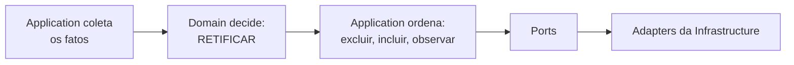

O Domain pode dizer:
> “A ação correta é RETIFICAR, com estas diferenças.”

Mas não deve dizer:
> “Abra uma transação Oracle, faça uma chamada HTTP, tente novamente e grave esta tabela.”

Da mesma maneira, a Application pode decidir a ordem operacional:

> excluir → incluir → observar

Mas não deveria inventar a regra que determina se o caso é uma retificação. Essa conclusão vem do Domain.

Esse é o ponto de separação mais importante do projeto.

<br>

---

## Resumo da Etapa 1 — Visão geral do produto e das camadas

* O backend sincroniza a fotografia desejada dos planos homologados com o PCA observado no PNCP.
* O Domain decide o que deve acontecer.
* A Application coordena quando e em que ordem as coisas acontecem.
* Ports descrevem capacidades necessárias sem escolher tecnologia.
* A futura Infrastructure implementará essas capacidades com Oracle, PNCP e Scriptcase.
* `PublicarPcaUseCase` conduz a execução; `ProcessadorUnidadeInterno` conduz cada unidade; `PublicarPcaResponse` representa o resultado global.

### Mapa mental

```text
Publicação do PCA
├── Entrada
│   └── PublicarPcaRequest
├── Application
│   ├── PublicarPcaUseCase
│   ├── preparação global
│   ├── varredura das unidades
│   └── processamento de cada unidade
├── Domain
│   └── decide a ação correta
├── Ports
│   └── capacidades exigidas pela Application
├── Infrastructure futura
│   └── Oracle, PNCP e Scriptcase
└── Saída
    └── PublicarPcaResponse
```

<br><br><br><br><br><br><br><br><br><br><br><br><br><br><br><br><br><br><br><br>

# Etapa 2 — Domain

A melhor maneira de entender o Domain deste projeto é enxergá-lo como uma máquina que recebe fatos confiáveis e devolve uma intenção de negócio.

```text
Planos e Demandas homologadas
+ estado operacional local
+ PCA observado no PNCP
              ↓
      Política do Domain
              ↓
PUBLICAR | RETIFICAR | EXCLUIR_PCA | NENHUMA_ACAO
```

O Domain não procura esses fatos no banco nem executa a decisão no PNCP.

<br>

## 1. Entidade, Value Object e política

Antes das classes, três conceitos:
* **Entidade**: possui identidade e continuidade. Uma Demanda continua sendo a Demanda de ID 1001, mesmo que alguns atributos mudem.
* **Value Object**: representa um valor válido. Um AnoExecucao(2027) importa por seu valor, não por uma identidade própria.
* **Política de domínio**: toma uma decisão de negócio envolvendo diferentes fatos e objetos, quando a regra não pertence naturalmente a uma única entidade.

O modelo principal é:

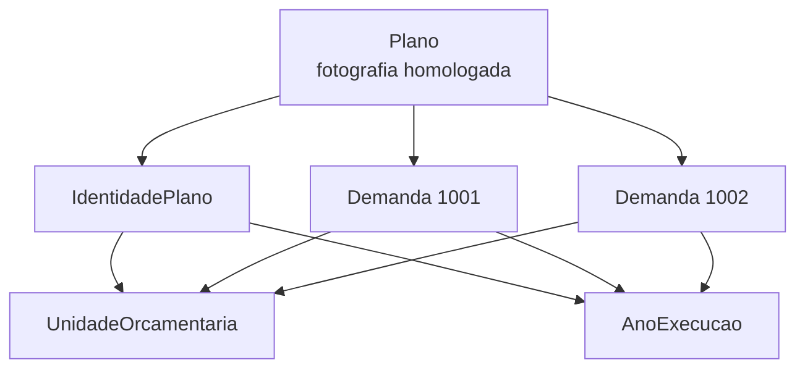

Um `Plano` representa a fotografia de uma Unidade Orçamentária em determinado exercício.

## 2. Plano: a fronteira de consistência

> Arquivo: [Plano.php](../../../backend/src/Domain/Entities/Plano.php)

1. Qual **problema** resolve? Representa uma versão homologada do plano e garante que sua coleção de Demandas seja coerente.
Ele reúne:
* identidade lógica do plano;
* versão;
* data de homologação;
* Demandas da fotografia vigente;
* eventual confirmação de sincronização daquela versão.

2. **Quem o cria**? Hoje, os testes criam Planos diretamente. 
No fluxo real, a Application pedirá ao futuro repositório Oracle que reconstrua esses objetos.

3. **Quem o chama**? Principalmente:
* a política, para obter as Demandas desejadas;
* a Application, para conhecer identidade, versão e confirmação;
* o futuro repositório, durante reconstrução e persistência.

4. **Quem ele chama**? Ele consulta:
* IdentidadePlano;
* UnidadeOrcamentaria;
* AnoExecucao;
* cada Demanda recebida.

Isso acontece para proteger suas invariantes.

5. **O que recebe**? No construtor:
* IdentidadePlano
* versão sequencial
* data da homologação
* Demandas
* data opcional da confirmação

6. **O que devolve**? Ele expõe a fotografia válida e informações sobre ela:
* getDemandas();
* getQuantidadeDemandas();
* possuiDemandas();
* possuiSincronizacaoConfirmada();
* identidade, ano, unidade, versão e datas.

7. **Onde aparece no fluxo**? Depois que a Application relê os dados sob exclusividade e antes que a política tome sua decisão.

8. **Por que está no Domain**? Porque regras como “todas as Demandas precisam pertencer à mesma unidade e exercício” devem valer independentemente de Oracle ou PNCP.

9. **As invariantes** protegidas por Plano. O construtor rejeita:
* versão menor ou igual a zero;
* qualquer elemento que não seja Demanda;
* Demandas que não participem da fotografia vigente;
* IDs de Demandas duplicados;
* Demanda de outra Unidade Orçamentária;
* Demanda de outro exercício.

Assim, se temos um objeto Plano, podemos confiar que:
```text
todas as Demandas
├── são participantes da fotografia vigente
├── possuem IDs únicos
├── pertencem à Unidade Orçamentária do Plano
└── pertencem ao exercício do Plano
```

10. **Um Plano pode não ter Demandas**? Sim — e isso é essencial.
Exemplo: `new Plano(..., demandas: [], ...)` representa uma fotografia conhecida e validamente vazia.

Isso é diferente de passar nenhum Plano para a política:

```text
[Plano sem Demandas] = conheço a fotografia e ela está vazia

[] = não recebi Plano algum; não posso concluir que a fotografia esteja vazia
```

Por isso a política rejeita `[]`, mas aceita um `Plano` cuja coleção de Demandas esteja vazia. Essa distinção evita excluir um PCA apenas porque uma consulta falhou ou não forneceu os dados esperados. Excluir um PCA a partir de [] seria perigoso: a ausência dos Planos poderia ter sido causada por consulta incompleta, erro de repositório ou chamada incorreta da política.

## 3. Demanda: o item que pode participar da fotografia

> Arquivo: [Demanda.php](../../../backend/src/Domain/Entities/Demanda.php)

1. Qual problema resolve? Representa um item de planejamento com identidade própria e os dados necessários para uma futura publicação.

2. Quem a cria? O futuro PlanoRepository, ao reconstruir o Plano com dados do Oracle. (Atualmente, os testes.)

3. Quem a chama?
* Plano, para validar pertencimento e situação;
* PoliticaProcessamentoPlano, indiretamente, para obter seus IDs;
* futuramente, a Infrastructure, ao transformar a fotografia desejada no payload do PNCP.

4. O que recebe? Recebe identidade e atributos do item, como:
* ID;
* situação;
* unidade e exercício;
* categoria;
* descrição;
* quantidade;
* valores monetários;
* catálogo;
* código do item;
* origem.

5. O que devolve? Disponibiliza esses dados de maneira tipada e responde: `$demanda->participaDaFotografiaVigente()`

6. Onde aparece no fluxo? Dentro do Plano, formando a fotografia desejada que será comparada ao PNCP.

7. Por que está no Domain? Porque “o que é uma Demanda válida” e “quais situações pertencem à fotografia vigente” são regras de negócio, não regras de banco ou transporte HTTP.

8. Quais situações participam? A decisão está no enum SituacaoDemanda:

| Situação | Participa da fotografia? |
|---|---:|
| `PLANEJADA` | Não |
| `HOMOLOGADA` | Sim |
| `COMPRADA` | Sim |
| `CANCELADA` | Não |
| `PUBLICADA` | Sim |

Isso significa que o Plano reconstruído para processamento não pode carregar uma Demanda planejada ou cancelada como se ainda pertencesse à fotografia vigente.

9. Validações próprias da Demanda. Ela também protege algumas regras:
* categoria deve ser 1 ou 2;
* quantidade deve ser positiva;
* catálogo deve ser 1 ou 2;
* origem deve ser N ou E.

Ainda há vários campos como strings e inteiros primitivos. Isso não é automaticamente errado: criar um Value Object para cada campo aumentaria muito o modelo sem necessariamente trazer comportamento relevante.

## 4. Principais Value Objects

> IdentidadePlano

Arquivo: [IdentidadePlano.php](../../../backend/src/Domain/ValueObjects/IdentidadePlano.php)

1. Problema: definir a identidade lógica de um Plano.
2. Quem o cria e quem o utiliza: é criado principalmente pelo repositório e pelos testes; `Plano` e componentes que precisam identificar ou comparar Planos utilizam o objeto.
3. Quais objetos ele utiliza: `UnidadeOrcamentaria` e `AnoExecucao`.
4. O que recebe: `UnidadeOrcamentaria` e `AnoExecucao`.
5. O que devolve: unidade, ano e comparação por igualdade.
6. Onde aparece: na identificação da fotografia do Plano que está sendo processada.
7. Por que está no Domain: a identidade do Plano é um conceito do negócio, não a chave física de uma tabela.

Portanto, a identidade lógica pode ser entendida assim: `Identidade do Plano = Unidade Orçamentária + exercício`

A versão não faz parte dessa identidade. Versão 1 e versão 2 representam versões diferentes do mesmo Plano lógico.

---

> AnoExecucao

Arquivo: [AnoExecucao.php](../../../backend/src/Domain/ValueObjects/AnoExecucao.php)

1. Problema: impedir que um inteiro qualquer seja tratado como exercício válido.
2. Quem chama: a fronteira de entrada, o repositório, `PublicarPcaRequest`, `IdentidadePlano`, `Plano` e `Demanda`.
3. Quem ele chama: ninguém.
4. O que recebe: um ano inteiro.
5. O que devolve: o ano já validado.
6. Onde aparece: em diferentes pontos do fluxo que precisam identificar ou limitar o exercício da publicação.
7. Por que está no Domain: a definição dos exercícios permitidos é uma restrição do negócio.

Atualmente, ele aceita somente o ano atual ou o próximo ano.

---

> EstadoOperacionalPublicacao

Arquivo: [EstadoOperacionalPublicacao.php](../../../backend/src/Domain/ValueObjects/EstadoOperacionalPublicacao.php)

1. Problema: representar o que o sistema local conhece sobre o estado operacional de uma publicação.
2. Quem o cria e quem o utiliza: futuramente, será reconstruído pelo adapter da persistência local; a política e a Application utilizam o objeto.
3. Quais objetos ele utiliza: `EstadoPublicacao` e, quando pertinente, `SequencialPca`.
4. O que recebe: o estado operacional e, quando pertinente, o sequencial do PCA.
5. O que devolve: permite consultar o estado, o sequencial associado e se a publicação é considerada ativa.
6. Onde aparece: é um dos fatos entregues à política.
7. Por que está no Domain: estados como publicado, excluído e não publicado possuem significado de negócio.

Ele pode representar:`NAO_PUBLICADO, PUBLICADO(sequencial), EXCLUIDO(último sequencial)`

---

> PcaObservado

Arquivo: [PcaObservado.php](../../../backend/src/Domain/ValueObjects/PcaObservado.php)

1. Problema: representar uma observação confiável do estado externo
2. Quem o cria e quem o utiliza: a Application o cria a partir do resultado fornecido pelo leitor do PNCP; a política e, posteriormente, a finalização utilizam o objeto.
3. Quais objetos ele utiliza: `SequencialPca` para um PCA ativo e a coleção validada de IDs de Demandas observadas.
4. O que recebe: ausência ou sequencial acompanhado dos IDs observados.
5. O que devolve: atividade, sequencial e IDs normalizados.
6. Onde aparece: representa o estado externo efetivamente observado usado na comparação com a fotografia desejada
7. Por que está no Domain: a política precisa raciocinar sobre conceitos como “PCA ativo com estas Demandas” sem conhecer HTTP, JSON ou detalhes da API do PNCP.

Existem duas construções válidas:

```php
PcaObservado::ausente();

PcaObservado::ativo(new SequencialPca(77), [1001, 1002]);
```

Os IDs ativos precisam ser inteiros e únicos e são mantidos em ordem normalizada.

---

> SequencialPca

Arquivo: [SequencialPca.php](../../../backend/src/Domain/ValueObjects/SequencialPca.php)

1. Problema: impedir que valores inválidos
2. Quem o cria e quem o utiliza: é criado a partir da leitura local ou da observação do PNCP; estado operacional, PCA observado, política e Application utilizam o objeto.
3. Quais objetos ele utiliza: nenhum colaborador; ele valida o inteiro positivo e oferece comparação por igualdade.
4. O que recebe: inteiro positivo.
5. O que devolve: valor e comparação por igualdade.
6. Onde aparece: na correlação entre o PCA conhecido localmente ao PCA observado externamente.
7. Por que está no Domain: a identidade operacional do PCA precisa permanecer válida e comparável.

## 5. Política de processamento dos Planos

> PoliticaProcessamentoPlano

Arquivo: [PoliticaProcessamentoPlano.php](../../../backend/src/Domain/Policies/PoliticaProcessamentoPlano.php)

1. Problema: -> comparar a fotografia desejada, -> o estado operacional conhecido -> e o PCA efetivamente observado -> para escolher a intenção de negócio correta.
2. Quem chama: na execução completa, `DecisorUnidadeSobExclusividade`, que estudaremos na Etapa 3.
3. Quem ela chama: nenhum Port ou serviço externo; apenas percorre `Plano`s e `Demanda`s, consulta Value Objects e cria um `ResultadoDecisaoProcessamentoPlano`.
4. O que recebe: os Planos que compõem a fotografia desejada, `EstadoOperacionalPublicacao` e `PcaObservado`.
5. O que devolve: `ResultadoDecisaoProcessamentoPlano`, contendo a decisão e os IDs das Demandas que precisam ser incluídas ou excluídas.
6. Onde aparece: Exatamente na fronteira entre "Application reuniu os fatos" -> Domain decide -> Application recebe a intenção
7. Por que está no Domain: escolher entre publicar, retificar, excluir ou não agir é uma decisão de negócio pura, independente de banco de dados, HTTP, PNCP ou transações.

## 6. As quatro decisões

A política reduz a decisão principal a esta tabela:

| Fotografia desejada | PCA observado | Decisão |
|---|---|---|
| Possui Demandas | Ausente | `PUBLICAR` |
| Possui Demandas | Ativo e diferente | `RETIFICAR` |
| Possui Demandas | Ativo e igual | `NENHUMA_ACAO` |
| Vazia | Ativo | `EXCLUIR_PCA` |
| Vazia | Ausente | `NENHUMA_ACAO` |

## 7. A verificação de coerência

Primeiro, é preciso entender 3 conceitos:

| Conceito | Significado | Pergunta respondida | Autoridade |
|---|---|---|---|
| Fotografia desejada | É o conjunto de Demandas vigentes que o SGI determina que deveriam compor o PCA. | O que deveria estar publicado? | Planos homologados no SGI |
| Estado local | É a memória local da integração sobre o vínculo com o PNCP. | Com qual PCA o sistema acredita possuir vínculo? | Registro operacional local |
| Observação externa | É a fotografia efetivamente encontrada no PNCP durante a consulta atual. | O que realmente existe agora no PNCP? | Consulta conclusiva ao PNCP |

Antes de comparar IDs, a política verifica se um PCA ativo observado é coerente com o vínculo operacional local.

```text
PCA observado está ativo?
├── não → comparação pode continuar
└── sim
    ├── estado local não está ativo → conflito
    ├── sequenciais são diferentes → conflito
    └── vínculo coerente → comparar fotografias
```

Exemplo bloqueado:
> Estado local: PUBLICADO com sequencial 77
> PNCP observado: ativo com sequencial 78

A política não escolhe retificar o PCA 78, porque ele não corresponde ao vínculo conhecido. Isso poderia modificar um PCA errado.

Por outro lado:
> Estado local: PUBLICADO com sequencial 77
> PNCP observado: ausente

A ausência externa definitiva prevalece sobre o vínculo local antigo. Se há fotografia desejada, a decisão é publicar novamente.

**PERGUNTA:** Se o estado local aponta para o PCA 77, uma consulta falha por timeout e não devolve o PCA, por que isso não autoriza PUBLICAR novamente?
<br>**RESPOSTA:** O timeout produz ausência incerta, não uma prova de inexistência. Republicar poderia criar um PCA duplicado; portanto, a Application falha com segurança e não entrega uma ausência inventada ao Domain.

**PERGUNTA:** Se o PCA 77 está definitivamente ausente, mas a listagem encontra o PCA 78 para a mesma UASG, por que o sistema não deve simplesmente adotar o 78?
<br>
**RESPOSTA:** O PCA 78 é apenas um candidato externo sem vínculo comprovado. Adotá-lo automaticamente poderia associar ao SGI uma publicação legada ou alheia. O resultado correto é conflito, exigindo migração ou reconciliação assistida.

### Combinações possíveis

| Fotografia desejada | Estado local | Observação externa | Interpretação |
|---|---|---|---|
| `[1001]` | `NAO_PUBLICADO` | Ausente | `PUBLICAR` |
| `[1001]` | `PUBLICADO(77)` | PCA 77 com `[1001]` | `NENHUMA_ACAO` |
| `[1001,1003]` | `PUBLICADO(77)` | PCA 77 com `[1001,1002]` | `RETIFICAR` |
| Vazia | `PUBLICADO(77)` | PCA 77 ativo | `EXCLUIR_PCA` |
| `[1001]` | `PUBLICADO(77)` | Ausência definitiva | `PUBLICAR` novamente |
| `[1001]` | `PUBLICADO(77)` | PCA 78 | Conflito |
| `[1001]` | `PUBLICADO(77)` | Consulta inconclusiva | Não decidir; falhar com segurança |
| `[1001]` | `NAO_PUBLICADO` | Candidato externo 78 | Conflito; não adotar |

## 8. Onde termina o Domain?

O Domain termina ao produzir algo semelhante a:

```text
RETIFICAR
├── excluir: [1002]
└── incluir: [1003]
```

A partir daí, são perguntas da Application:
* Há evidência suficiente para executar?
* O resultado desejado respeita o limite externo?
* Qual comando precisa ser criado?
* A transação já começou?
* Em que ordem os comandos serão enviados?
* A escrita teve resultado certo ou incerto?
* É necessário observar novamente?
* Houve convergência?
* Devemos fazer commit ou rollback?
* O que deve ser auditado?

A fronteira é:

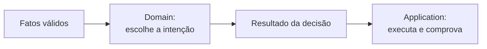

O Domain não é responsável por todo comportamento importante do sistema. Ele é responsável pelas regras de negócio puras. 
Segurança transacional e coordenação externa são igualmente importantes, mas pertencem à Application.

### Sequência de responsabilidades da Application após a decisão política RETIFICAR


```text
Application após RETIFICAR
├── preparar
│   ├── validar limite
│   └── produzir comandos
├── executar
│   └── excluir → incluir
├── comprovar
│   ├── observar novamente
│   └── reconciliar, se necessário
└── concluir
    ├── persistir
    ├── auditar
    └── commit ou rollback
```

<br>

---

## Resumo da Etapa 2 — Domain

* Plano é a fronteira que protege a coerência da fotografia homologada.
* Demanda representa cada item participante dessa fotografia.
* Value Objects impedem que valores inválidos ou ambíguos circulem.
* PoliticaProcessamentoPlano compara desejado, conhecido localmente e observado externamente.
* A política devolve uma intenção; não escreve, não abre transação e não audita.
* Um Plano vazio é uma fotografia vazia conhecida; nenhum Plano é falta de informação.

### Mapa mental

```text
Domain
├── Plano
│   ├── identidade = UO + exercício
│   ├── versão e homologação
│   └── Demandas da fotografia vigente
├── Demanda
│   ├── identidade
│   ├── situação
│   ├── pertencimento à UO/ano
│   └── dados de publicação
├── Fatos
│   ├── EstadoOperacionalPublicacao
│   └── PcaObservado
└── PoliticaProcessamentoPlano
    ├── PUBLICAR
    ├── RETIFICAR
    ├── EXCLUIR_PCA
    └── NENHUMA_ACAO
```

<br><br><br><br><br><br><br><br><br><br>

# Etapa 3 — Application pelo fluxo feliz

Vamos acompanhar uma publicação concreta:
* CNPJ: válido
* Exercício: 2027
* Modo: INDIVIDUAL
* Unidade: UO 101 / UASG 928344
* Fotografia desejada: [1001, 1002]
* Estado local: NAO_PUBLICADO
* PNCP: nenhum PCA candidato

Resultado esperado:
```text
PUBLICAR [1001, 1002]
    ↓
PNCP cria PCA 77
    ↓
nova observação encontra PCA 77 com [1001, 1002]
    ↓
estado local atualizado
    ↓
Planos confirmados + auditoria + commit
    ↓
Response CONCLUIDA
```


<br><br>

---

## 1. O mapa completo da chamada

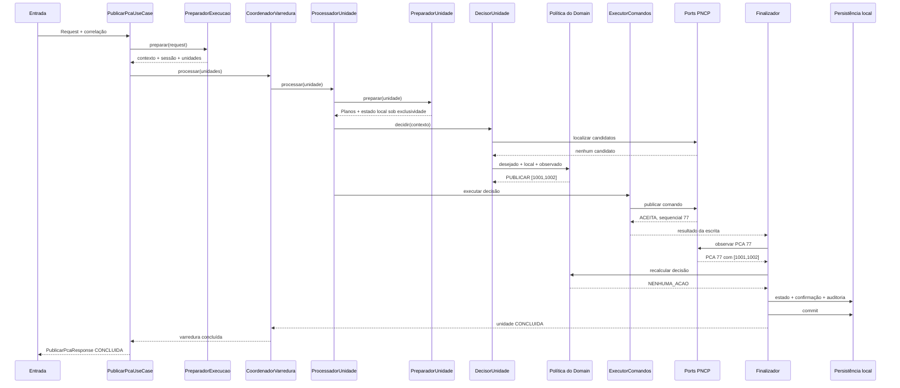

Agora percorreremos essa cadeia progressivamente.

<br><br>

---

## 2. PublicarPcaUseCase: entrada da operação

Arquivo: [PublicarPcaUseCase.php](../../../backend/src/Application/UseCases/PublicarPca/PublicarPcaUseCase.php)

Ele não percorre diretamente os Planos nem escreve no PNCP. Seu fluxo é mais alto:
1. preparar execução
2. varrer unidades
3. classificar resultado global
4. montar Response

No caminho feliz:
```text
preparação = PREPARADA
varredura = CONCLUÍDA
resultados unitários = sem pendências
Response = CONCLUIDA
```

---

## 3. PreparadorExecucaoPublicacaoPca: preparar o que é global

Arquivo: [PreparadorExecucaoPublicacaoPca.php](../../../backend/src/Application/UseCases/PublicarPca/PreparadorExecucaoPublicacaoPca.php)

**Necessidade:** Ele trabalha antes do processamento individual das unidades pois precisa reunir o contexto comum a toda a execução.

No cenário estudado, ele faz:
1. Resolver usuário e lotação
2. Listar identidades de Planos do exercício
3. Conferir/congelar a estratégia anual: se o processamento será individual ou consolidado.
4. Formar as unidades externas
5. Autenticar uma vez no PNCP
6. Devolver tudo preparado (apenas como um envelope tipado: informa se a preparação foi concluída, interrompida ou não encontrou unidades)

A leitura global das identidades tem por por objetivo planejar a viagem e, assim, descobrir:
* quantas unidades serão visitadas;
* quais UOs participam;
* qual UASG corresponde a cada uma;
* Qual o ano exercício;

Exemplo:
```text
Identidades encontradas:
├── UO 101 / 2027
├── UO 102 / 2027
└── UO 103 / 2027
```

### Listar apenas identidades para descobrir a topologia da execução

* No modo individual:
```text
Identidade Plano UO 101 → Unidade externa UO 101
Identidade Plano UO 102 → Unidade externa UO 102
```
* No modo consolidado:
```text
Identidades UO 101 + UO 102 + UO 103
                    ↓
uma unidade externa consolidada
```

### No nosso exemplo, o resultado da preparação carrega:
```text
ContextoUsuario
SessaoPncp
Estrategia INDIVIDUAL
UnidadesExternas:
└── UO 101 / UASG 928344 / exercício 2027
```

---

## 4. CoordenadorVarreduraUnidades: percorrer a lista

Arquivo: [CoordenadorVarreduraUnidades.php](../../../backend/src/Application/UseCases/PublicarPca/CoordenadorVarreduraUnidades.php)

**Necessidade:** visitar todas as unidades planejadas e acumular seus resultados.

Antes do foreach, ele protege a topologia:
* não aceita lista vazia;
* não aceita elementos que não sejam unidades externas;
* não mistura modo individual e consolidado;
* não mistura exercícios;
* não aceita unidades duplicadas;
* no consolidado, exige exatamente uma unidade conjunta.

Depois: `foreach ($unidades as $unidade) {$desfecho = $this->processador->processar(...);}`

### No nosso exemplo existe apenas uma unidade:

```text
visitadas = 1
resultados unitários = 1
falha sistêmica = nenhuma
```

Uma falha sistêmica interromperia as unidades seguintes. Uma pendência unitária conhecida pode ser registrada sem necessariamente interromper toda a varredura — veremos isso nas falhas.

---

## 5. ProcessadorUnidadeInterno: o trilho de uma unidade

Arquivo: [ProcessadorUnidadeInterno.php](../../../backend/src/Application/UseCases/PublicarPca/ProcessadorUnidadeInterno.php)

**Necessidade:** manter fixa a sequência principal de uma unidade: `preparar -> decidir -> despachar`

Ele não precisa conhecer todos os motivos de falha. Cada etapa pode devolver:
* um contexto que permite continuar; ou
* um desfecho terminal que deve subir pela cadeia.

Isso funciona como um trilho com saídas de emergência:
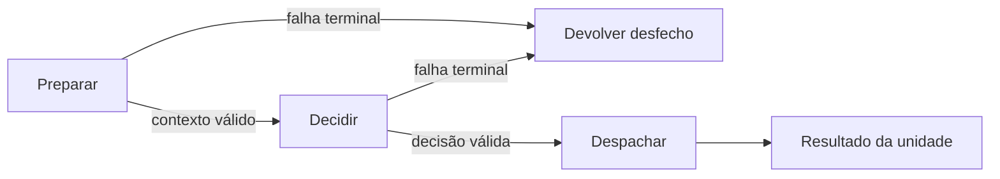

---

## 6. PreparadorUnidadeSobExclusividade: reconstruir a verdade vigente

Arquivo: [PreparadorUnidadeSobExclusividade.php](../../../backend/src/Application/UseCases/PublicarPca/PreparadorUnidadeSobExclusividade.php)

**Necessidade:** obter uma fotografia local coerente enquanto a unidade está protegida contra processamento concorrente.

### O fluxo real é:

```text
iniciar transação/lock da unidade
    ↓
reler identidades dos Planos
    ↓
selecionar identidades pertencentes à unidade
    ↓
reconstruir os Planos e suas Demandas
    ↓
consultar estado operacional local
    ↓
devolver contexto sob exclusividade
```

### Por que reler as identidades?

A preparação global pode ter acontecido alguns instantes antes. Entre aquela listagem e o início do processamento, alguma informação poderia ter mudado.

O sistema não usa cegamente a listagem antiga:
```text
Listagem global
└── serve para planejar a varredura

Releitura sob exclusividade
└── serve para decidir e escrever com dados vigentes
```

No nosso exemplo, ele devolve:
```text
ContextoUnidadeSobExclusividade
├── unidade UO 101 / UASG 928344
├── Plano
│   ├── Demanda 1001
│   └── Demanda 1002
└── estado operacional: NAO_PUBLICADO
```

A partir daqui, a transação da unidade permanece aberta até o commit ou rollback.

---

## 7. DecisorUnidadeSobExclusividade: obter a observação e consultar o Domain

Arquivo: [DecisorUnidadeSobExclusividade.php](../../../backend/src/Application/UseCases/PublicarPca/DecisorUnidadeSobExclusividade.php)

**Necessidade:** reunir o fato externo correto e entregá-lo à política.

Este Decisor atua logo após a reconstrução dos dados locais e antes do despacho de uma eventual escrita externa no PNCP.

Sua função prática é coordenar a coleta de fatos externos para entregá-los à política de negócios, agindo como um intermediário estratégico que sabe como buscar a informação, mas deixa a decisão final para o domínio.

Ele é acionado pelo `ProcessadorUnidadeInterno` e interage diretamente com o `LeitorPncp` e a `PoliticaProcessamentoPlano`.

Ao receber **a sessão, o CNPJ e o contexto da unidade**, ele avalia o estado local para definir a estratégia de leitura.

Se houvesse um vínculo local ativo (`estado PUBLICADO(77)`), ele apenas observaria o PCA conhecido (`leitorPncp->observarPcaConhecido(...,77)`). No entanto, no cenário atual, este vínculo não existe, portanto, o estado local é `NAO_PUBLICADO`, o que o força a buscar candidatos externamente (`leitorPncp->localizarCandidatos(...)`). 
Como o simulador do leitor retorna uma lista vazia, o componente conclui que a observação externa está ausente (`PcaObservado::ausente()`). 
Com esses três fatos em mãos:
- a fotografia desejada formada pelas Demandas 1001 e 1002, 
- o estado local (não publicado) e 
- a ausência externa

o decisor finalmente consulta a política de domínio. 

A política do domínio recebe Planos e dita o veredito: PUBLICAR, mas calcula inclusões e exclusões usando IDs de Demanda.

Por fim, o decisor empacota esses fatos e a respectiva decisão no objeto `ContextoUnidadeComDecisao`, que serve puramente como um transporte seguro e validado para a próxima etapa do processo.

---

## 8. DespachadorComandosUnidade: ligar execução e finalização

Arquivo: [DespachadorComandosUnidade.php](../../../backend/src/Application/UseCases/PublicarPca/DespachadorComandosUnidade.php)

O despachador conecta duas etapas operacionais e protege suas exceções. Esta é uma pequena ligação que precisa aparecer porque faz parte da cadeia real.

**Necessidade:** executar a decisão e, se for possível continuar, montar o contexto de finalização.

Seu papel é:
```text
executor produz resultados de escrita
                ↓
despachador junta todos os fatos
                ↓
finalizador observa e conclui
```

Ele cria o ContextoFinalizacaoProcessamentoUnidade, que reúne:
* usuário;
* sessão e CNPJ;
* unidade e Planos;
* estado local inicial;
* observação inicial;
* decisão inicial;
* resultados das escritas.

**Esse objeto evita passar uma longa lista de argumentos isolados ao finalizador.**

---

## 9. ExecutorComandosUnidade: transformar intenção em escrita

Arquivo: [ExecutorComandosUnidade.php](../../../backend/src/Application/UseCases/PublicarPca/ExecutorComandosUnidade.php)

### Responsabilidade prática
* Problema: executar a operação externa correspondente à decisão.
* Quem chama: `DespachadorComandosUnidade`; em uma reconciliação, também o finalizador.
* Quem ele chama: `EscritorPncp` e, para exclusão integral, a Port de evidência homologada.
* O que recebe: `ContextoUnidadeComDecisao`.
* O que devolve: resultados de escrita ou desfecho terminal.
* Onde aparece: depois da decisão e antes da observação final.

O método escolhe o caminho:

```php
return match ($decisao) {
    PUBLICAR     => publicar(...),
    RETIFICAR    => retificar(...),
    EXCLUIR_PCA => excluirPca(...),
    NENHUMA_ACAO => [],
};
```

* Caminho PUBLICAR

Primeiro, ele recupera os objetos Demanda da fotografia vigente.

A política devolveu IDs porque sua decisão trata pertencimento: `[1001, 1002]`

Mas o comando de publicação precisa dos objetos completos:
```text
Demanda 1001
├── descrição
├── quantidade
├── valores
└── demais dados

Demanda 1002
└── ...
```

Depois ele valida o limite de 1000 itens antes de qualquer escrita.

Por fim, cria: `new ComandoPublicarPca($cnpj,$unidadeExterna,$demandas)` e chama: `$escritorPncp->publicar($sessao, $comando);`

No cenário feliz, o double responde:
```text
ResultadoPublicacaoPncp
├── situação: ACEITA
└── sequencial: 77
```

O Command é a ordem tipada. Ainda não é JSON e não conhece endpoint.
> Application: “publique este CNPJ, nesta unidade, com estas Demandas”

> Infrastructure futura: “vou converter isso para o payload e o HTTP reais do PNCP”

---

## 10. FinalizadorProcessamentoUnidadeInterno: comprovar e concluir

Arquivo: [FinalizadorProcessamentoUnidadeInterno.php](../../../backend/src/Application/UseCases/PublicarPca/FinalizadorProcessamentoUnidadeInterno.php)

Esta é a classe mais densa do fluxo, mas sua ideia pode ser entendida em quatro blocos: Observar, Recalcular, Persistir e Concluir.

### Responsabilidade prática

* Problema: impedir que uma escrita seja considerada concluída sem convergência comprovada.
* Quem chama: `DespachadorComandosUnidade.`
* Quem ele chama: leitor PNCP, política, executor em eventual reconciliação, repositório, estado operacional, auditoria e unidade de trabalho.
* O que recebe: `ContextoFinalizacaoProcessamentoUnidade`.
* O que devolve: `DesfechoProcessamentoUnidade`.
* Onde aparece: depois da escrita e antes do resultado unitário.

### Bloco 1 — Observar

Como a publicação foi aceita com sequencial 77, o finalizador chama: `observarPcaConhecido(..., 77)` e o leitor retorna:
```text
PcaObservado
├── sequencial: 77
└── itens: [1001, 1002]
```

### Bloco 2 — Recalcular

O finalizador não compara os arrays manualmente. Ele pergunta novamente à política:
* Fotografia desejada: [1001, 1002]
* Estado coerente após escrita: PUBLICADO(77)
* Nova observação: PCA 77 com [1001, 1002]

E a política devolve: `NENHUMA_ACAO`

Aqui NENHUMA_ACAO funciona como prova de convergência: *"Se decidíssemos novamente agora, não haveria mais nada a alterar."*

### Bloco 3 — Persistir

Somente depois dessa prova ele:
1. registra o novo estado operacional PUBLICADO(77);
2. confirma a sincronização dos Planos ainda não confirmados;
3. registra auditoria da publicação;
4. confirma a unidade de trabalho.

Essas gravações locais e o commit acontecem de forma atômica dentro da transação da unidade.

### Bloco 4 — Concluir

Ele produz um resultado unitário:
```text
ResultadoProcessamentoUnidade
├── situação: CONCLUIDO
├── decisão: PUBLICAR
├── sequencial: 77
├── incluídos: 2
└── excluídos: 0
```

Observe a diferença:
> Resultado da decisão: *“precisamos PUBLICAR”*

> Resultado da unidade: *“PUBLICAR foi executado e sua convergência foi comprovada”*

### E a reconciliação?
No caminho feliz, não ocorre. Ela só é considerada quando a escrita teve resultado incerto e a nova observação mostra que ainda falta algo. Esse assunto pertence principalmente à Etapa 4.

---

## 11. Retorno pela cadeia

Depois da finalização, o resultado sobe:

```text
Finalizador
    ↓ Desfecho unitário CONCLUIDO
Despachador
    ↓
ProcessadorUnidadeInterno
    ↓
CoordenadorVarreduraUnidades
    ↓ varredura concluída com 1 resultado
PublicarPcaUseCase
    ↓
PublicarPcaResponse
```
---

## 12. PublicarPcaResponse: resultado global

Arquivo: [PublicarPcaResponse.php](../../../backend/src/Application/Results/PublicarPcaResponse.php)

### Responsabilidade prática

1. Problema: representar o resultado global sem combinações incoerentes.
2. Quem cria: PublicarPcaUseCase.
3. Quem ela chama: nenhum serviço; apenas valida suas próprias invariantes.
4. O que recebe: situação, resultados unitários, falha global, contagens e correlação.
5. O que devolve: dados tipados para a futura apresentação.
6. Onde aparece: no final do caso de uso.
7. Por que está na Application: é a saída do caso de uso, não uma entidade de negócio nem uma resposta HTTP concreta.

No exemplo:
```text
PublicarPcaResponse
├── situação: CONCLUIDA
├── unidades planejadas: 1
├── unidades visitadas: 1
├── unidades não processadas: 0
├── falha global: nenhuma
├── correlação: preservada
└── resultados
    └── UO 101: PUBLICAR concluído, PCA 77
```

`CONCLUIDA` só aceita resultados unitários: `CONCLUIDO`; ou `SEM_ALTERACAO`. Se existir unidade bloqueada ou com falha reconciliável, a situação global será `CONCLUIDA_COM_PENDENCIAS`.

<br><br>

---

## O que muda nas outras três decisões?

O começo é o mesmo:
```text
UseCase
→ preparação global
→ coordenador
→ processamento da unidade
→ preparação sob exclusividade
→ observação
→ política
```
A diferença principal aparece no executor.

<br>

* `RETIFICAR`

---

```text
Estado local: PUBLICADO(77)
Desejado:  [1001, 1003]
Observado: PCA 77 com [1001, 1002]
```
Domain:
```text
RETIFICAR
├── excluir [1002]
└── incluir [1003]
```
Application:
```text
validar fotografia final ≤ 1000
    ↓
excluir [1002]
    ↓ somente se a exclusão for aceita
incluir [1003]
    ↓
observar PCA 77 novamente
    ↓
recalcular com a política
```
O mesmo finalizador exige `NENHUMA_ACAO` como prova final.

<br>

* `EXCLUIR_PCA`

---

```text
Desejado: []
Observado: PCA 77 ativo
```
Antes da escrita, o executor exige uma evidência homologada do cancelamento que tornou a unidade vazia.

Depois:
```text
excluir PCA 77
    ↓
comprovar ausência externa
    ↓
registrar estado local EXCLUIDO(77)
    ↓
confirmar Planos + auditar + commit
```

<br>

* `NENHUMA_ACAO`

---

```text
Desejado: [1001, 1002]
Observado: PCA 77 com [1001, 1002]
```
O executor devolve uma lista vazia de escritas: `NENHUMA_ACAO => []`

O finalizador:
1. confirma novamente que a política continua devolvendo NENHUMA_ACAO;
2. persiste confirmações locais necessárias;
3. não registra auditoria de alteração externa;
4. faz commit;
5. devolve SEM_ALTERACAO.
Nesse caminho, não há uma segunda consulta ao PNCP: a observação inicial válida já é a prova utilizada, e nenhuma escrita ocorreu depois dela.

<br><br>

---

## Value Objects

Arquivo: [ChaveUnidadeTrabalho.php](../../../backend/src/Application/ValueObjects/ChaveUnidadeTrabalho.php)

Identifica o alvo da exclusividade transacional: a estratégia de um exercício ou o processamento de uma unidade externa específica.

```text
ChaveUnidadeTrabalho
├── ESTRATEGIA_ANUAL
│   ├── identifica pelo ano
│   └── protege adoção/conferência da estratégia
└── UNIDADE_EXTERNA
    ├── identifica pelo ano + unidade externa
    └── protege decisão, escrita e confirmação da unidade
```

### Responsabilidade prática

* Problema: identificar qual alvo precisa de exclusividade.
* Quem a cria: o preparador global ou o preparador de uma unidade.
* Quem a recebe: `UnidadeDeTrabalhoPort::iniciar()`.
* Quem ela chama: apenas objetos usados para representar e comparar sua identidade.
* O que recebe: um ano ou uma unidade externa.
* O que devolve: escopo, ano, eventual unidade e comparação por igualdade.

### A solução para lidar com o problema da concorrência

O uso de locks (bloqueios) é uma das soluções mais eficientes e tradicionais para evitar problemas de duplicidade causados por requisições concorrentes.

Quando múltiplas requisições tentam criar ou modificar o mesmo recurso simultaneamente (uma condição de corrida), o lock garante que apenas uma requisição processe a operação por vez, forçando as outras a esperar ou falhar.

Com lock:

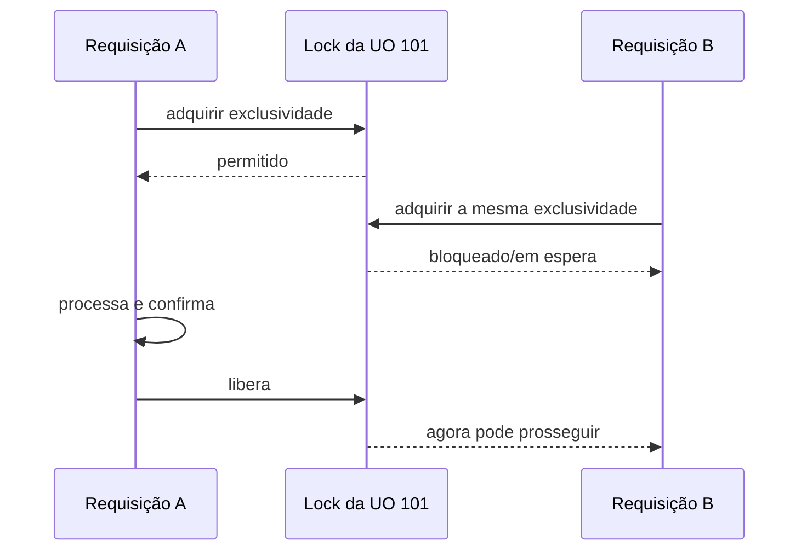

<br><br>

---

## Resumo da Etapa 3 — Application pelo fluxo feliz

* O Use Case conduz a execução global, mas delega o trabalho.
* O preparador global resolve usuário, estratégia, unidades e sessão uma vez.
* O coordenador percorre as unidades.
* Cada unidade segue preparar → decidir → executar → finalizar.
* O preparador unitário reconstrói a fotografia dentro da exclusividade.
* O decisor obtém a observação correta e consulta o Domain.
* O executor transforma a decisão em Commands e usa as Ports de escrita.
* O finalizador só confirma localmente depois de comprovar convergência.
* A Response agrega os resultados unitários e a situação global.

### Mapa mental

```text
PublicarPcaUseCase
├── Preparador global
│   ├── usuário
│   ├── identidades
│   ├── estratégia
│   ├── unidades externas
│   └── sessão PNCP
├── Coordenador da varredura
│   └── para cada unidade:
│       └── ProcessadorUnidadeInterno
│           ├── preparar sob exclusividade
│           ├── observar + decidir no Domain
│           ├── executar Commands
│           └── finalizar
│               ├── observar
│               ├── recalcular
│               ├── persistir/auditar
│               └── commit
└── PublicarPcaResponse
```

<br><br>

---

##  Perguntas e Respostas

### 1. Por que a preparação global lista identidades globalmente, mas a preparação da unidade reconstrói novamente os Planos sob exclusividade?

Porque as duas leituras têm objetivos diferentes.

* **Leitura global: planejar a viagem**

O `PreparadorExecucaoPublicacaoPca` lista apenas identidades para descobrir: quantas unidades serão visitadas; quais UOs participam; qual UASG corresponde a cada uma; se o processamento será individual ou consolidado.

Isso é suficiente para montar o roteiro da varredura. Ainda não é a fotografia utilizada para escrever no PNCP.

* **Releitura unitária: obter a verdade para decidir**

Algum tempo pode passar antes de a unidade ser processada. Nesse intervalo: uma Demanda pode ser homologada;uma Demanda pode ser cancelada;uma nova versão do Plano pode surgir;uma unidade pode deixar de participar.

Por isso, ao chegar à UO 101, o `PreparadorUnidadeSobExclusividade`: abre o lock/transação da UO 101 -> relê sua identidade -> reconstrói o Plano e suas Demandas atuais

A regra prática é:
* Listagem global: define quem pretendemos visitar
* Releitura sob exclusividade: define o que realmente será decidido e publicado

Se o sistema usasse a fotografia lida antes do lock, poderia publicar dados que já mudaram.

É um cuidado contra o problema conhecido como “tempo entre verificar e usar”:
```text
10:00 — leio [1001, 1002]
10:01 — Demanda 1002 é cancelada
10:02 — publico usando a leitura antiga
```

> A releitura sob exclusividade evita esse uso de uma fotografia desatualizada.

### 2. No cenário PUBLICAR, por que o finalizador chama novamente a política depois de observar o PCA criado?

Para verificar se ocorreu a convergência. Porém, o resultado esperado não é a mesma decisão anterior. Por exemplo:

Antes da publicação:
* Desejado: [1001, 1002]
* Observado: ausente
* Decisão: PUBLICAR

Depois da escrita e da nova observação:
* Desejado: [1001, 1002]
* Observado: [1001, 1002]
* Decisão recalculada: NENHUMA_ACAO

Portanto:
* Decisão antes da escrita: PUBLICAR
* Decisão depois da escrita: NENHUMA_ACAO

Se a política ainda devolvesse `PUBLICAR`, isso significaria que o PCA continuava ausente e que a publicação não foi comprovada. 
Se devolvesse `RETIFICAR`, significaria que o PCA existe, mas sua fotografia ainda está diferente.

> A prova de convergência é: *"Depois da operação, a política passa a dizer que nenhuma alteração é necessária."*

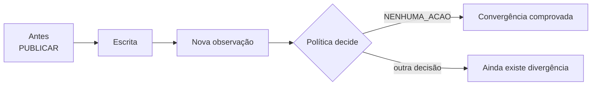

**Nota:** O SGI e o PNCP não precisam ser idênticos em todos os dados. Na V1, a política compara principalmente o pertencimento das Demandas pelos IDs.

## 3. Qual é a diferença entre o resultado PUBLICAR devolvido pela política e o resultado unitário CONCLUIDO devolvido pelo finalizador?

Eles representam momentos diferentes.
* PUBLICAR: é uma <ins>intenção</ins> produzida pelo Domain antes da escrita
* CONCLUIDO: é um <ins>resultado_ comprovado</ins>, produzido pela Application depois de:
    1. executar a escrita;
    2. observar o PNCP novamente;
    3. recalcular a política;
    4. obter NENHUMA_ACAO;
    5. persistir estado e auditoria;
    6. fazer commit.

CONCLUIDO não substitui PUBLICAR; eles respondem a perguntas diferentes:
* `PUBLICAR`: Qual ação era necessária?
* `CONCLUIDO`: O processamento terminou com sucesso comprovado?

## 4. Em NENHUMA_ACAO, por que o executor não escreve no PNCP, mas o finalizador ainda precisa atuar?

Como nenhuma escrita aconteceu depois, não há uma alteração externa que exija nova observação.

Mesmo assim, a unidade ainda está com sua transação aberta. O finalizador precisa:
1. confirmar novamente que aqueles fatos produzem NENHUMA_ACAO;
2. registrar a confirmação de sincronização dos Planos, se estiver pendente;
3. manter ou ajustar o estado operacional, se necessário;
4. não criar auditoria de alteração externa;
5. fazer commit;
6. devolver SEM_ALTERACAO.

Assim:
```text
NENHUMA_ACAO
    ↓
nenhuma escrita externa
    ↓
confirmar que a observação inicial prova convergência
    ↓
concluir registros locais
    ↓
commit
    ↓
SEM_ALTERACAO
```

A diferença entre os caminhos é:
```text
PUBLICAR
→ escrever
→ observar novamente
→ comprovar convergência
→ persistir e concluir

NENHUMA_ACAO
→ não escrever
→ reutilizar a observação inicial válida
→ persistir e concluir
```

<br><br><br><br><br><br><br><br><br><br>

# 4. Falhas e transações

> Um rollback local não desfaz automaticamente algo que já aconteceu no PNCP.

## 1. As duas unidades de trabalho

O fluxo utiliza a mesma UnidadeDeTrabalhoPort, mas com duas chaves (alvo da exclusividade transacional) e com durações diferentes:

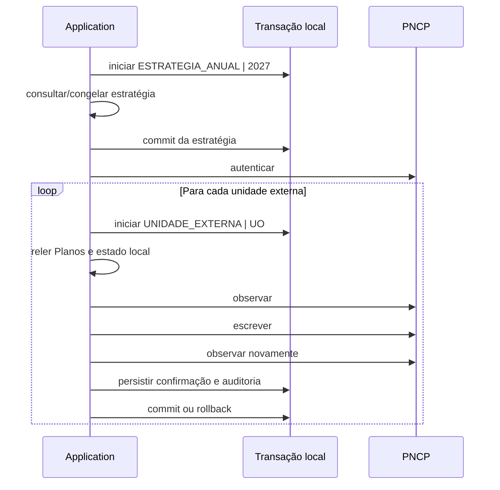

---

## 2. Transação da estratégia anual

### Quando começa?

Depois de `resolver o contexto do usuário` e `listar as identidades participantes do exercício` então o preparador chama `$unidadeDeTrabalho->iniciar(ChaveUnidadeTrabalho::estrategiaAnual($ano))`

Para o exercício, o sistema:
1. consulta a estratégia corrente;
2. valida as identidades contra essa estratégia;
3. consulta se já existe estratégia adotada;
4. adota a corrente, se ainda não existe;
5. ou confirma que a adotada continua igual à corrente.

### Quando termina?

A transação termina antes de:
* autenticar no PNCP;
* iniciar a varredura;
* observar ou escrever externamente.

Ela é curta porque sua finalidade é somente congelar uma configuração consistente para o exercício.
Não faz sentido manter o lock anual durante toda a execução. Isso impediria outras requisições de conferir a mesma estratégia enquanto uma varredura potencialmente longa acessa o PNCP.

### Commit

O commit ocorre quando:
* a estratégia corrente é válida;
* foi adotada ou coincide com a já adotada;
* não houve inconsistência.

### Rollback
O rollback ocorre se, depois do início:
* a estratégia corrente não estiver disponível;
* houver divergência;
* a adoção falhar;
* uma consulta falhar;
* a confirmação falhar;
* surgir uma exceção inesperada.

Se essa preparação falhar: rollback da estratégia -> preparação interrompida -> não autenticar -> não iniciar varredura

---

## 3. Transação da unidade externa

### Quando começa?

Para cada unidade visitada, antes da releitura dos Planos: `$unidadeDeTrabalho->iniciar(ChaveUnidadeTrabalho::unidadeExterna($unidade))`. A partir daí, a unidade fica sob exclusividade local.

### O que acontece dentro dela?
```text
Iniciar unidade
    ↓
reler identidades
    ↓
reconstruir Planos
    ↓
ler estado operacional
    ↓
observar PNCP
    ↓
decidir
    ↓
escrever, se necessário
    ↓
observar novamente
    ↓
comprovar convergência
    ↓
persistir estado, confirmação e auditoria
    ↓
commit
```

Diferentemente da transação anual, esta permanece aberta durante as chamadas ao PNCP.

### Por que manter o lock durante a escrita externa?

Para impedir que outra execução processe a mesma unidade com fatos locais concorrentes.

### Quando ocorre commit?

Somente depois que:
1. a convergência externa foi comprovada;
2. o estado operacional final foi registrado;
3. as versões dos Planos foram confirmadas;
4. a auditoria necessária foi registrada.

Para NENHUMA_ACAO, também existe commit, mesmo sem escrita externa, porque pode ser necessário confirmar localmente a sincronização dos Planos.

### Quando ocorre rollback?

Entre outros casos:
* unidade bloqueada ou incoerente;
* releitura dos Planos falhou;
* observação não foi conclusiva;
* política encontrou conflito;
* limite de itens foi excedido;
* evidência de cancelamento não está disponível;
* escrita não levou à convergência;
* persistência local falhou;
* auditoria falhou;
* o próprio commit falhou.

## 4. Por que as duas transações são separadas?

### Elas protegem alvos diferentes

* Transação anual: protege a estratégia do exercício 2027
* Transação unitária: protege o processamento da UO 101

### Elas possuem durações diferentes
* Estratégia anual: curta, apenas consulta/adota/confirma
* Unidade externa: mais longa, inclui observação e escrita externas

### Uma falha unitária não deve reverter a estratégia anual

Depois que a estratégia de 2027 foi adotada corretamente, uma falha posterior ao publicar a UO 101 não significa que a estratégia anual esteja errada.

### Unidades diferentes podem ter destinos diferentes

No modo individual:
* UO 101 → CONCLUIDO
* UO 102 → BLOQUEADO
* UO 103 → CONCLUIDO

A estratégia anual permanece válida. Cada unidade possui seu próprio resultado e sua própria transação.

### Uma grande transação seria problemática

Uma transação abrangendo estratégia e todas as unidades:
* manteria locks por muito tempo;
* aumentaria contenção;
* perderia o progresso já comprovado de unidades anteriores;
* ainda não conseguiria reverter atomicamente o PNCP;
* faria uma falha na última unidade atingir todas as anteriores.

## 5. As quatro classificações de escrita

O enum [SituacaoEscritaPncp.php](../../../../Desktop/backend/src/Application/Enums/SituacaoEscritaPncp.php) possui:ACEITA, REJEITADA, RESULTADO_INCERTO, FALHA_SISTEMICA

Não precisamos memorizar as classes de Result. Precisamos entender o significado.

* `ACEITA`
O PNCP forneceu uma resposta válida indicando que recebeu a operação: Escrita aceita -> observar novamente -> convergência comprovada?

Mesmo `ACEITA` não dispensa a observação. Aceitação da requisição não prova que o estado final possui exatamente a fotografia desejada.

* `REJEITADA`
O PNCP forneceu uma rejeição conhecida e válida, como uma resposta contratual 400 ou 422.
Sabemos que o comando foi rejeitado
    ↓
não repetir cegamente
    ↓
observar e calcular o estado seguro
A rejeição é um resultado conhecido, não uma exceção técnica descontrolada.

* `RESULTADO_INCERTO`
A requisição pode ter chegado ao PNCP, mas a resposta não permite saber o resultado.

Exemplos futuros:
* timeout depois do envio;
* conexão interrompida após transmitir a requisição;
* resposta malformada;
* 429;
* 5xx;
* resposta de sucesso incompleta.

Nesse caso: Pode ter escrito ou pode não

* `FALHA_SISTEMICA`
A execução não possui condições seguras para continuar.

Ela interrompe a unidade, faz rollback local e pode interromper a varredura.

É importante que o futuro adapter classifique corretamente. Um timeout após o envio não deve ser chamado genericamente de falha sistêmica, porque pode ter produzido efeito externo. Ele deve ser classificado como resultado incerto.

## 6. Por que uma escrita incerta nunca é repetida diretamente?

Suponha:

1. Application envia: inserir Demanda 1003
2. PNCP executa a inclusão
3. resposta se perde por timeout

A Application não sabe que a inclusão ocorreu.

Se repetir diretamente, pode:
* criar duplicidade;
* produzir uma rejeição;
* tornar o estado ainda mais difícil de interpretar.

O fluxo correto é:

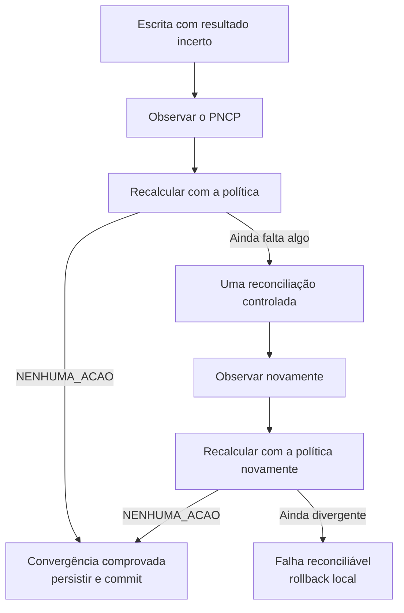

### Retry vs Reconciliação

* Retry direto: repetir o mesmo comando porque não recebemos resposta
* Reconciliação: observar o estado real e calcular uma nova decisão

A reconciliação pode acabar produzindo um comando parecido, mas ele nasce de fatos novos e de uma nova decisão, não da suposição de que a primeira tentativa falhou.

## 7. Por que existe uma nova observação?

Porque existem três níveis de conhecimento:
* Comando enviado: sabemos o que pedimos
* Resultado técnico: sabemos algo sobre a resposta
* Observação externa: sabemos o que efetivamente existe

Exemplo:
```text
Pedido:
PUBLICAR [1001, 1002]

Resposta:
ACEITA, sequencial 77

Observação:
PCA 77 contém [1001, 1002]

Nova decisão:
NENHUMA_ACAO
```

Somente o último passo comprova convergência.

A observação também protege contra:
* resposta positiva incompleta;
* aplicação parcial;
* atraso ou comportamento inesperado;
* escrita incerta;
* estado externo alterado por outro agente.

## 8. Por que no máximo uma reconciliação adicional?

Sem limite, poderíamos entrar num ciclo de escrever->observar

Se a escrita foi ACEITA, mas o estado continuou divergente, não existe reconciliação automática adicional. O sistema não possui a justificativa da incerteza para repetir efeitos; devolve uma pendência reconciliável.

## 9. O papel do FinalizadorProcessamentoUnidadeInterno

Nesta etapa, leia essa classe como quatro blocos, não linha por linha: Observar, Recalcular, 3. Persistir, 4. Encerrar

### Bloco 1 — Observar

Depois da escrita:
* usa o sequencial retornado por uma publicação aceita; ou
* usa o sequencial já conhecido em retificação/exclusão;
* se não houver sequencial seguro, busca candidatos sem adotá-los automaticamente.

Resultados inconclusivos, conflitantes e sistêmicos são classificados antes de continuar.

### Bloco 2 — Recalcular

Entrega à mesma política:
* os mesmos Planos desejados;
* um estado operacional coerente para a avaliação;
* a nova observação.

Se a política devolver NENHUMA_ACAO então a convergência foi comprovada.

Se ainda houver diferença:
* pode haver uma única reconciliação, se a escrita foi incerta;
* caso contrário, resulta em pendência ou bloqueio.

### Bloco 3 — Persistir

Depois da convergência:
1. deriva o estado operacional final;
2. registra esse estado, se mudou;
3. confirma as versões dos Planos;
4. registra auditoria, quando houve alteração externa.

A auditoria só existe para uma ação comprovada: `PUBLICAR`, `RETIFICAR`, `EXCLUIR_PCA`

`NENHUMA_ACAO`, tentativas e falhas não geram histórico funcional de alteração.

### Bloco 4 — Encerrar

Por fim:
* se commit concluído: CONCLUIDO ou SEM_ALTERACAO
* se alguma etapa falhou: rollback -> BLOQUEADO, FALHA_RECONCILIAVEL ou falha sistêmica

## 10. O rollback não desfaz o PNCP

Se, ao publicar, registro de auditoria local falhar, o sistema não tenta excluir automaticamente o PCA 77 como compensação. Uma compensação também poderia falhar e ampliar a incerteza.

Esse caso exige:
* diagnóstico seguro;
* nova observação em execução posterior;
* reconciliação consciente;
* eventualmente atuação assistida.

Isso explica por que uma transação local não fornece atomicidade distribuída.

## 11. DesfazedorUnidadeProcessamento

Arquivo: [DesfazedorUnidadeProcessamento.php](../../../backend/src/Application/UseCases/PublicarPca/DesfazedorUnidadeProcessamento.php)

### Responsabilidade prática

Define a segurança do encerramento do fluxo.

* Problema: garantir rollback e decidir qual falha deve prevalecer.
* Quem chama: preparador, decisor, executor, despachador e finalizador.
* Quem ele chama: `UnidadeDeTrabalhoPort::desfazer()`.
* O que recebe: o desfecho original que motivou o rollback.
* O que devolve: o desfecho original ou uma falha sistêmica de rollback.
* Onde aparece: em praticamente todas as saídas anormais da unidade.

Seu comportamento é:
```text
Existe uma falha original
    ↓
tentar rollback

rollback concluído?
├── sim → preservar a falha original
└── não → falha do rollback prevalece
```

### Por que a falha do rollback prevalece?

Exemplo:
* Falha original: “PCA observado está conflitante”
* Falha posterior: “Não foi possível desfazer a transação local”

O conflito original continua existindo, mas agora há um problema mais grave: *"Não sabemos se a unidade local foi encerrada com segurança."*

Por isso o resultado passa a ser uma falha sistêmica de desfazimento: `DESFAZIMENTO_UNIDADE_FALHOU`

O rollback desfaz as alterações locais ainda não confirmadas, como estado operacional, confirmação dos Planos e auditoria transacional. Ele não desfaz a publicação já realizada no PNCP. Por isso o sistema registra uma falha segura e exige reconciliação posterior.

## 12. Mapa das falhas

```text
Falha antes de iniciar transação
└── não há transação confirmadamente aberta para desfazer

Falha depois de iniciar
└── rollback obrigatório
    ├── rollback funciona → preservar falha original
    └── rollback falha → falha de rollback prevalece

Escrita aceita
└── observar e comprovar

Escrita rejeitada
└── não repetir cegamente; observar e classificar

Escrita incerta
└── observar
    ├── convergiu → commit
    └── não convergiu → no máximo uma reconciliação

Convergência externa + falha local
└── rollback apenas local
    └── reconciliação consciente posterior
```

<br>

---

## Resumo da etapa 4 - Falhas e Transações

* A transação anual congela a estratégia e termina antes do PNCP.
* Cada unidade externa possui sua própria transação e exclusividade.
* O PNCP não participa atomicamente da transação local.
* Commit unitário só ocorre depois da convergência e da persistência local.
* Escrita incerta nunca é repetida diretamente.
* A nova observação transforma incerteza técnica em fatos para uma nova decisão.
* Existe no máximo uma reconciliação adicional.
* Rollback local não desfaz efeitos externos.
* Se o rollback falhar, essa falha prevalece.

## Mapa mental

```text
Transações
├── Estratégia anual
│   ├── iniciar por exercício
│   ├── conferir/adotar
│   └── commit antes do PNCP
└── Unidade externa
    ├── iniciar por alvo
    ├── reler sob exclusividade
    ├── observar e escrever
    ├── comprovar convergência
    ├── persistir/auditar
    └── commit ou rollback

Escrita incerta
└── observar → recalcular → uma reconciliação → observar
```

<br><br><br><br><br><br><br><br><br><br>

# 5. Testes e preparação para Infrastructure

O objetivo de [FluxoConcretoApplicationTest.php](../../../backend/tests/Application/UseCases/PublicarPca/FluxoConcretoApplicationTest.php) é provar:
> A Application completa já funciona quando recebe implementações controladas de suas Ports, mesmo sem Oracle, HTTP ou Scriptcase reais.

“Fluxo concreto” não significa que as integrações são concretas. Significa que todas as classes de Domain e Application usadas na cadeia são as classes reais, monstrando como todo o grafo funciona hoje sem adapters concretos.


## Quais Ports ainda são doubles?

| Port/contrato | Double atual | Adapter futuro esperado |
|---|---|---|
| `ContextoUsuarioPort` | `ContextoFluxoConcreto` | Contexto do Scriptcase e/ou consulta Oracle |
| `PlanoRepository` | `RepositoryFluxoConcreto` | Repositório Oracle que reconstrói o Aggregate |
| `EstrategiaPublicacaoPort` | `EstrategiaFluxoConcreto` | Adapter Oracle para consultar e adotar estratégia |
| `UnidadeDeTrabalhoPort` | `UnidadeTrabalhoFluxoConcreto` | Sessão/transação Oracle com locks |
| `AutenticadorPncp` | `AutenticadorFluxoConcreto` | Autenticador HTTPS/cURL do PNCP |
| `EstadoOperacionalPublicacaoPort` | `EstadoFluxoConcreto` | Adapter Oracle para estado em `PAC_PLANOS` |
| `LeitorPncp` | `LeitorFluxoConcreto` | Cliente HTTP paginado do PNCP |
| `EscritorPncp` | `EscritorFluxoConcreto` | Cliente HTTP para publicação, inclusão e exclusão |
| `EvidenciaCancelamentoHomologadoPort` | `EvidenciaFluxoConcreto` | Consulta Oracle do cancelamento homologado |
| `RegistroAuditoriaPort` | `AuditoriaFluxoConcreto` | Persistência Oracle em `PAC_HISTORICOS` |
| `LoggerInterface` | `NullLogger` | Adapter PSR-3 para o destino técnico do ambiente |

## O que acontecerá nas sprints da Fase 5?

* Sprint 5.1: observar antes de implementar. 
Ela não começa criando adapters. Primeiro deve verificar no ambiente real:
    * ADOdb/OCI8 disponível no Scriptcase;
    * ciclo e compartilhamento da conexão;
    * schema, joins, tipos e constraints;
    * representação Oracle de datas e decimais;
    * cURL, OpenSSL e CA bundle;
    * contrato atual do manual e OpenAPI PNCP;
    * chamadas autorizadas no ambiente de treinamento.

* 5.2 → sessão Oracle, transações, estratégia e locks
* 5.3 → PlanoRepository e mapeamento do Aggregate
* 5.4 → estado operacional, contexto, auditoria e logs
* 5.5 → transporte HTTPS e autenticação
* 5.6 → datas, decimais e payloads
* 5.7 → leitura, paginação e ausência definitiva
* 5.8 → escritas e resultados incertos
* 5.9 → contratos dos adapters

## O que deverá mudar?

Deverão ser adicionados:

```text
Infrastructure
├── adapters Oracle
├── sessão compartilhada
├── transações e locks concretos
├── mapeamento Oracle → Domain
├── cliente cURL
├── autenticação PNCP
├── leitura paginada
├── serialização de payloads
├── classificação de respostas
├── auditoria concreta
└── observabilidade técnica
```

Os novos adapters implementarão as Ports existentes. Exemplo: `final class LeitorPncpHttp implements LeitorPncp {detalhes de HTTP e paginação}`

## O que não deverá mudar?

* Plano e Demanda;
* PoliticaProcessamentoPlano;
* as quatro decisões;
* PublicarPcaUseCase;
* a sequência do processamento;
* excluir → incluir → observar;
* a regra de comprovação por convergência;
* o limite de uma reconciliação;
* os contratos de Commands e Results;
* as classificações de falha;
* a separação das duas transações.

Os testes atuais não serão substituídos. Eles continuarão provando a lógica interna enquanto novos testes comprovam os adapters.

Domain e Application devem permanecer estáveis, salvo se evidências contratuais reais da Sprint 5.1 demonstrarem uma incompatibilidade objetiva.

## Perguntas e respostas

1. Por que o nome “Fluxo Concreto” não significa que Oracle e PNCP reais estão sendo utilizados?

Porque o fluxo utiliza as classes reais de Domain e Application, mas substitui as fronteiras externas por doubles. Assim, o teste comprova a coordenação completa, mas não comprova SQL, HTTP, TLS, paginação ou locks reais.

2. Ao substituir EscritorFluxoConcreto por um adapter HTTP, por que ExecutorComandosUnidade não deveria mudar?

Porque ele depende de EscritorPncp, não de cURL ou de uma classe concreta. O executor continua determinando qual Command enviar e em qual ordem. O adapter apenas traduz o Command para o contrato técnico do PNCP e devolve o Result tipado esperado.

## Resumo da etapa

* FluxoConcretoApplicationTest usa Domain e Application reais.
* Apenas as fronteiras externas são doubles.
* O teste demonstra os principais fluxos e o modo consolidado.
* Os doubles serão substituídos por adapters, não por novas regras.
* A Sprint 5.1 é um gate de evidências, não uma corrida para escrever adapters.
* A composição definitiva pertence à Fase 6.

## Mapa mental
```text
Hoje
├── Domain real
├── Application real
└── Ports
    └── doubles de teste

Fase 5
├── Domain permanece
├── Application permanece
└── Ports
    └── adapters reais
        ├── Oracle
        ├── PNCP
        └── ambiente Scriptcase

Fase 6
└── composição explícita do grafo real
```

<br><br><br><br><br><br><br><br><br><br>

# 7. Explicação do backend em aproximadamente cinco minutos

Este backend sincroniza os Planos homologados do SGI com os PCAs publicados no PNCP. A fonte da fotografia desejada é o conjunto de Planos e Demandas vigentes no SGI, enquanto o PNCP fornece o estado externo observado.
O Domain representa `Plano`, `Demanda`, Value Objects e a política de processamento. Essa política recebe a fotografia desejada, o vínculo operacional local e o PCA observado, e escolhe uma de quatro decisões: publicar, retificar, excluir integralmente ou não fazer nada. Ela não acessa banco nem HTTP.
A Application coordena o processo. O `PublicarPcaUseCase` prepara a execução, congela a estratégia anual, forma as unidades externas e autentica no PNCP. Depois, um coordenador percorre cada unidade. Sob exclusividade local, os Planos são relidos, o estado operacional é consultado e o PNCP é observado. A política decide, o executor converte a decisão em Commands e as Ports realizam as escritas.
A resposta técnica de uma escrita nunca é suficiente. O finalizador observa o PNCP novamente e consulta a mesma política. Quando ela passa a devolver `NENHUMA_ACAO`, a convergência foi comprovada. Só então o sistema registra o estado operacional, confirma as versões dos Planos, grava auditoria e faz commit.
Existem duas transações locais. Uma transação curta congela a estratégia do exercício. Outra protege cada unidade externa durante sua releitura, decisão, escrita e confirmação. O PNCP não participa da transação local; portanto, rollback no Oracle não desfaz automaticamente algo já escrito externamente.
Escritas incertas não são repetidas cegamente. O sistema observa o estado externo, recalcula a decisão e permite no máximo uma reconciliação adicional.
Hoje, todo esse grafo funciona com doubles das Ports, demonstrado pelo `FluxoConcretoApplicationTest`. A Fase 5 não deve redesenhar a regra ou a Application: deve implementar adapters Oracle, PNCP e Scriptcase que satisfaçam os contratos existentes. Antes disso, a Sprint 5.1 precisa comprovar os contratos reais dos ambientes.
