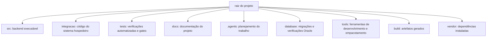
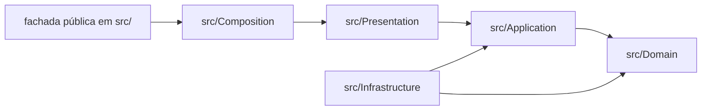

# Catálogo de diretórios

**Classificação documental:** Apoio  
**Status:** Vigente  
**Autoridade/Escopo:** mapa das pastas do projeto; não define comportamento

Responde: “Em qual pasta procuro ou crio isso?”.

Este catálogo explica **onde** cada tipo de artefato fica e por que a pasta
existe. Para descobrir a função de um arquivo específico, consulte o
[catálogo navegável de arquivos](catalogo_de_arquivos.md). Para executar os
scripts do projeto, consulte o
[catálogo de comandos Composer](catalogo_de_comandos_composer.md).

Diretórios gerados, como `build/` e `vendor/`, podem não existir logo após o
clone. Eles aparecem aqui porque fazem parte do fluxo de desenvolvimento e
entrega, embora não sejam versionados.

## 1. Visão geral

| Diretório | Finalidade | Versionado? |
| --- | --- | --- |
| `.agents/` | Guarda planos, checkpoints e registros usados para conduzir sprints e microciclos. | Sim |
| `build/` | Recebe artefatos gerados localmente, incluindo o pacote autocontido. Seu conteúdo pode ser recriado. | Não |
| `database/` | Guarda migrações Oracle versionadas, verificações de implantação e seeds descartáveis separados por ambiente. | Sim |
| `docs/` | Reúne documentação vigente, histórica, investigativa e diagramas. | Sim |
| `integracao/` | Guarda código pertencente ao sistema que hospeda o backend, atualmente a aplicação Blank do Scriptcase. | Sim |
| `src/` | Contém o código de produção do backend, organizado pelas responsabilidades arquiteturais. | Sim |
| `tests/` | Contém testes locais, integrações controladas e contratos opt-in para fronteiras reais. | Sim |
| `tools/` | Contém programas auxiliares usados para construir ou verificar entregáveis. | Sim |
| `vendor/` | Contém as dependências instaladas pelo Composer e o autoloader gerado. | Não |

## 2. Código de produção — `src/`

| Diretório | Responsabilidade |
| --- | --- |
| `src/Domain/` | Conceitos e regras centrais do negócio, sem conhecer Oracle, PNCP, Scriptcase ou outras camadas externas. |
| `src/Application/` | Coordena os casos de uso e declara os contratos necessários para executar a publicação. |
| `src/Presentation/` | Converte entradas externas em chamadas da Application e transforma respostas em modelos seguros para apresentação. |
| `src/Infrastructure/` | Implementa acesso ao Oracle, PNCP, HTTP, serialização e observabilidade. |
| `src/Composition/` | Monta os objetos concretos e conecta as implementações externas aos contratos internos. |

Os arquivos PHP colocados diretamente em `src/`, como
`PublicadorPcaScriptcase.php`, formam a fachada pública consumida pela Blank.
Eles ficam na raiz do namespace para oferecer um ponto de entrada estável sem
expor a organização interna ao Scriptcase.

### 2.1 Subdiretórios do Domain

| Diretório | Conteúdo |
| --- | --- |
| `src/Domain/Entities/` | Entidades reconhecidas por identidade. |
| `src/Domain/ValueObjects/` | Valores imutáveis validados pelo próprio tipo. |
| `src/Domain/Policies/` | Decisões de negócio que combinam conceitos do domínio. |
| `src/Domain/Facts/` | Fatos imutáveis de algo já ocorrido. |
| `src/Domain/Ports/` | Contratos que pertencem ao domínio. |
| `src/Domain/Enums/` | Vocabulários fechados do domínio. |
| `src/Domain/Exceptions/` | Violações das invariantes do domínio. |

### 2.2 Subdiretórios da Application

| Diretório | Conteúdo |
| --- | --- |
| `src/Application/UseCases/` | Fluxos que coordenam uma intenção do usuário; a publicação fica em `PublicarPca/`. |
| `src/Application/Ports/` | Capacidades externas de que o caso de uso precisa. |
| `src/Application/Contracts/` | Contratos entre colaboradores da própria Application. |
| `src/Application/Commands/` | Ordens tipadas destinadas aos executores externos. |
| `src/Application/Results/` | Resultados tipados das etapas e do caso de uso. |
| `src/Application/ValueObjects/` | Valores usados para transportar contexto com significado. |
| `src/Application/Enums/` | Estados e ações possíveis na orquestração. |

### 2.3 Subdiretórios da Presentation e Composition

| Diretório | Conteúdo |
| --- | --- |
| `src/Presentation/Inputs/` | Entrada validada na fronteira de apresentação. |
| `src/Presentation/Controllers/` | Aciona o caso de uso e trata a fronteira de entrada. |
| `src/Presentation/Presenters/` | Converte a resposta em representação pública. |
| `src/Presentation/ViewModels/` | Dados seguros devolvidos ao consumidor. |
| `src/Presentation/Facades/` | Fachada interna que reúne Controller e Presenter. |
| `src/Presentation/Exceptions/` | Falhas de validação próprias dessa fronteira. |
| `src/Composition/` | Composition Root, composição de execução e executor adaptado ao Scriptcase. |

### 2.4 Subdiretórios da Infrastructure

| Diretório | Conteúdo |
| --- | --- |
| `src/Infrastructure/Oracle/` | Implementações que usam a conexão ADOdb emprestada. |
| `src/Infrastructure/Oracle/Adodb/` | Encapsulamento da conexão, binds e charset. |
| `src/Infrastructure/Oracle/Plano/` | Reconstrução e confirmação de Planos e Demandas. |
| `src/Infrastructure/Oracle/Estrategia/` | Consulta e adoção da estratégia anual. |
| `src/Infrastructure/Oracle/EstadoOperacional/` | Leitura e persistência do estado local da publicação. |
| `src/Infrastructure/Oracle/Contexto/` | Resolução do usuário e de sua lotação. |
| `src/Infrastructure/Oracle/Auditoria/` | Registro da auditoria de negócio confirmada. |
| `src/Infrastructure/Oracle/Observabilidade/` | Persistência dos eventos técnicos em CLOB após o encerramento da transação de negócio. |
| `src/Infrastructure/Oracle/Transacao/` | Transações e locks Oracle. |
| `src/Infrastructure/Pncp/` | Implementações da comunicação com o PNCP. |
| `src/Infrastructure/Pncp/Autenticacao/` | Autenticação e sessão externa. |
| `src/Infrastructure/Pncp/Leitura/` | Consultas e paginação. |
| `src/Infrastructure/Pncp/Escrita/` | Publicação, retificação e exclusão. |
| `src/Infrastructure/Pncp/Http/` | Transporte HTTP e representação de respostas. |
| `src/Infrastructure/Pncp/Serializacao/` | Conversão entre objetos internos e payloads externos. |
| `src/Infrastructure/Pncp/Observabilidade/` | Registro técnico das chamadas ao PNCP. |
| `src/Infrastructure/Observabilidade/` | Eventos técnicos compartilhados pela execução. |

## 3. Integração com o sistema hospedeiro

| Diretório | Finalidade |
| --- | --- |
| `integracao/scriptcase/` | Adaptações versionadas que pertencem a aplicações Scriptcase. |
| `integracao/scriptcase/PCA_PUBLICAR_B/` | Código do evento `onExecute` da Blank que valida a requisição, chama a fachada, registra eventos e renderiza a interface. |

Essa separação deixa claro que a Blank **consome** o backend, mas não faz parte
de `src/`. No servidor, ela carrega o autoloader instalado em
`backend/vendor/autoload.php`.

## 4. Testes e contratos — `tests/`

| Diretório | Finalidade |
| --- | --- |
| `tests/Domain/`, `tests/Application/`, `tests/Presentation/`, `tests/Infrastructure/` e `tests/Composition/` | Espelham as áreas de produção e verificam seus comportamentos locais. |
| `tests/Integration/` | Verifica a colaboração entre componentes reais usando fronteiras controladas, sem depender automaticamente de serviços reais. |
| `tests/Contract/` | Mantém contratos e gates opt-in que comprovam fronteiras externas em etapas autorizadas. |
| `tests/Contract/Support/` | Reúne suporte compartilhado entre contratos de mais de uma sprint. |
| `tests/Support/` | Reúne objetos de teste reutilizáveis pela suíte local. |

As pastas `tests/Contract/Sprint51/` até `Sprint85/` preservam a preparação e
as provas de cada etapa. Elas não significam que todos esses gates devam ser
executados a cada alteração; o catálogo de comandos informa quais acessam
recursos reais e quais exigem autorização.

## 5. Ferramentas e artefatos gerados

### 5.1 Banco de dados

| Diretório | Finalidade | Responde |
| --- | --- | --- |
| `database/migrations/` | Mantém alterações incrementais de DDL ou dados de referência que acompanham uma implantação. | "O que alterar?" |
| `database/checks/` | Mantém consultas somente leitura executadas antes e depois de uma migração. | "Como conferir?" |
| `database/seeds/` | Reserva massa descartável e identificada para DEV ou HML; não recebe dados transacionais de produção. | "Qual massa descartável de DEV/HML?" |
| `database/deployments/` | Registra provisoriamente o estado das migrações em cada ambiente enquanto não existe histórico automatizado no banco. | "O que ocorreu em cada ambiente?" |

As migrações são artefatos permanentes: depois de aplicadas em um ambiente,
não devem ser reescritas. O projeto ainda não adotou um executor automático;
o procedimento e a limitação atual estão registrados em `database/README.md`.
Os subdiretórios `sprint85_contencao_hml/` e `sprint85_smoke_hml/` formam
camadas reversíveis: a segunda depende do estado produzido pela primeira e
deve ser limpa antes dela.

### 5.2 Ferramentas e resultados gerados

| Diretório | Finalidade |
| --- | --- |
| `tools/package/` | Contém `build.php`, que gera o pacote, e `verify.php`, que confere o resultado produzido. |
| `build/pca-pncp-backend/` | Pacote autocontido destinado à instalação dentro da pasta remota `backend/`. Contém somente `src/`, `vendor/` e o manifesto. |
| `build/pca-pncp-log-gate/` | Artefato temporário do Microciclo 6 para o validaSGI; contém o pacote principal em `backend/` e o runtime mínimo da probe em `gate/`. |
| `build/pca-pncp-containment-gate/` | Artefato temporário do Microciclo 7 para o validaSGI; contém o pacote principal e apenas o runtime do gate de contenção. |
| `build/composer-cache/` | Cache local usado durante a construção para evitar downloads desnecessários. |
| `vendor/` | Dependências da cópia de desenvolvimento; não deve ser confundido com o `vendor/` que vai dentro do pacote. |

`tools/` contém código-ferramenta. `build/` contém o resultado descartável
dessas ferramentas. Essa diferença é a mesma existente entre uma forma e o
objeto produzido por ela: a ferramenta é mantida; o pacote pode ser apagado e
reconstruído.

## 6. Documentação — `docs/`

| Diretório | Finalidade |
| --- | --- |
| `docs/vigentes/autoritativos/` | Fontes oficiais de regras, modelo, decisões de integração, fluxo e roadmap. |
| `docs/vigentes/operacional/` | Estado corrente, evidências, gates e próxima etapa. |
| `docs/vigentes/apoio/` | Guias, glossário e catálogos que explicam as fontes oficiais sem criar novas regras. |
| `docs/investigacoes/` | Pesquisas e evidências que não definem o comportamento vigente. |
| `docs/historico/` | Versões substituídas preservadas para auditoria e aprendizado. |
| `docs/diagramas/` | Diagramas e visões visuais do projeto. |

A classificação e a precedência completas estão em
[`docs/README.md`](../../README.md).

## 7. Planejamento dos agentes — `.agents/`

| Diretório | Finalidade |
| --- | --- |
| `.agents/sprints/planos/` | Planos aprovados e registros associados às sprints. |
| `.agents/sprints/prompts/` | Prompts preservados para continuidade do trabalho. |
| `.agents/planejamento/` | Material de planejamento transversal. |
| `.agents/planejamento/checkpoints/` | Pontos de continuidade registrados durante trabalhos extensos. |
| `.agents/planejamento/sinteses/` | Sínteses de contexto para retomada. |
| `.agents/arquivado/` | Materiais de agentes que deixaram de ser correntes. |

## 8. Como escolher uma pasta

| Se o novo artefato... | Diretório inicial a considerar |
| --- | --- |
| expressa regra ou conceito puro do negócio | `src/Domain/` |
| coordena o fluxo de uma intenção do usuário | `src/Application/` |
| adapta entrada ou saída pública | `src/Presentation/` |
| fala com Oracle, PNCP ou outro mecanismo externo | `src/Infrastructure/` |
| conecta implementações concretas | `src/Composition/` |
| pertence à aplicação Blank | `integracao/scriptcase/PCA_PUBLICAR_B/` |
| verifica comportamento automaticamente | área correspondente em `tests/` |
| auxilia construção ou verificação do projeto | `tools/` |
| altera estrutura ou dados de referência do Oracle durante implantação | `database/migrations/` |
| confere uma migração sem alterar o Oracle | `database/checks/` |
| é resultado gerado por uma ferramenta | `build/` |
| explica sem criar uma regra | `docs/vigentes/apoio/` |

Este quadro orienta a primeira busca. A responsabilidade real do artefato deve
confirmar a escolha; um nome técnico isolado não determina sua camada.
