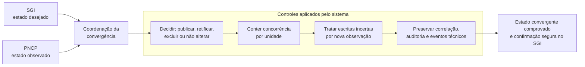
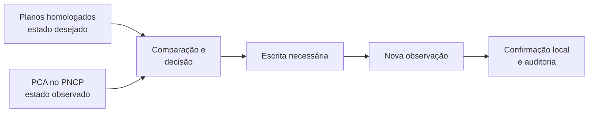
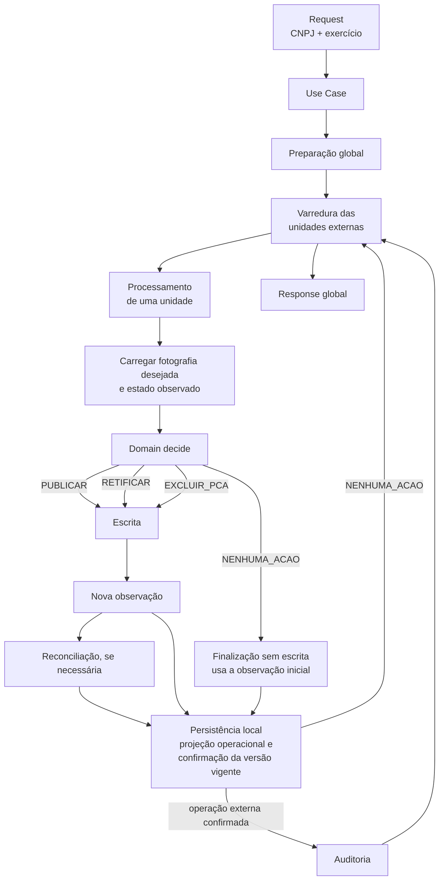
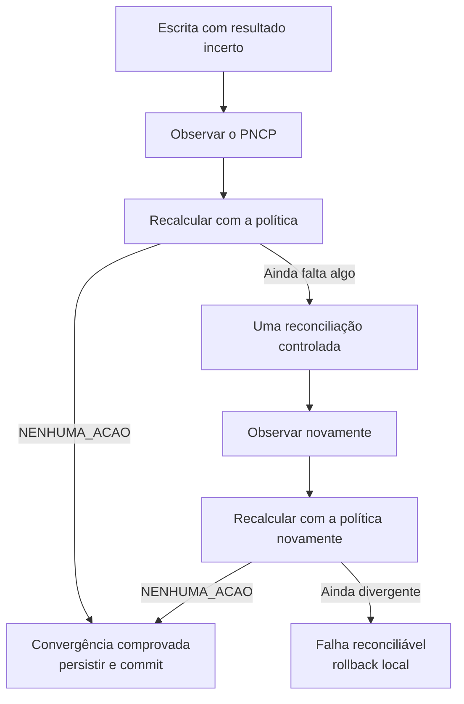
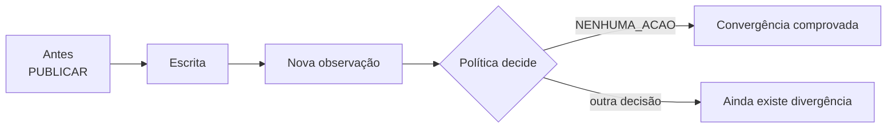
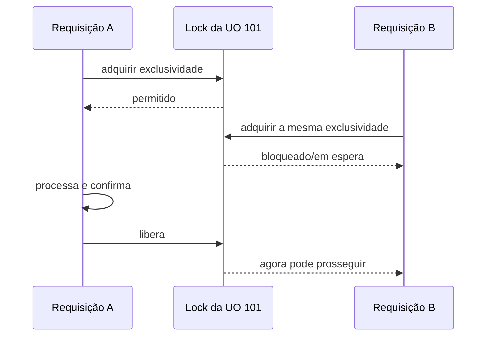
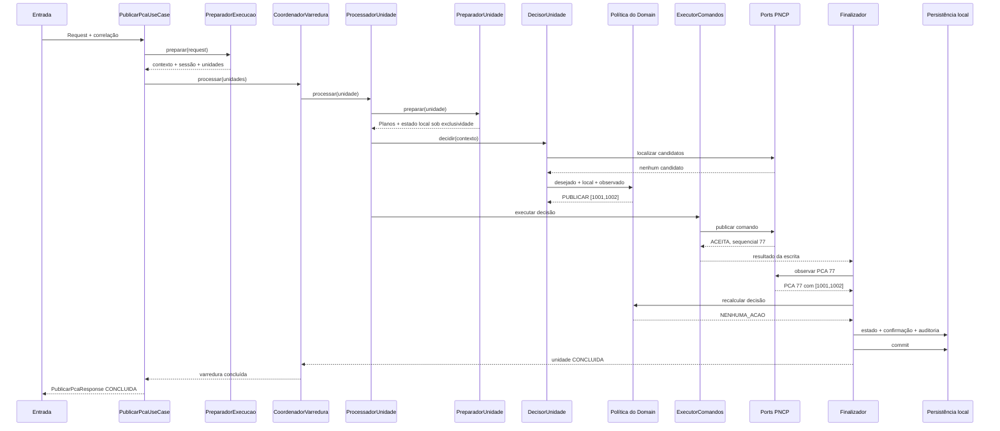

# Visão executiva do projeto PCA/PNCP

**Classificação documental:** Apoio  
**Status:** Vigente  
**Escopo:** visão atemporal do problema, da solução e de seus principais controles

Este documento explica visualmente como o sistema mantém o Plano de
Contratações Anual do SGI alinhado ao PNCP. Ele não substitui as regras e
decisões das [fontes autoritativas](../../../README.md) nem a
[situação operacional](../../operacional/situacao_operacional.md), que
concentra a condição do produto, as restrições correntes e as ações seguras.

## O problema e a solução

O sistema está construído, integrado à aplicação Blank do Scriptcase,
empacotado como release autocontida e instalado em produção. Mudanças de fase,
pendências externas e permissões para novas execuções são deliberadamente
registradas apenas no estado operacional, evitando que esta visão envelheça.

## É um processo de sincronização

> A nova observação é importante porque uma resposta técnica de sucesso não prova, sozinha, que o estado externo ficou correto.
>
> O objetivo real é alcançar a convergência: estado observado no PNCP = estado desejado pelo sistema

## O fluxo geral

### Cenário de escrita incerta

## A prova de convergência

> Depois da operação, a política passa a dizer que nenhuma alteração é
> necessária.

## Controle de concorrência por lock

## Mapa completo da chamada

