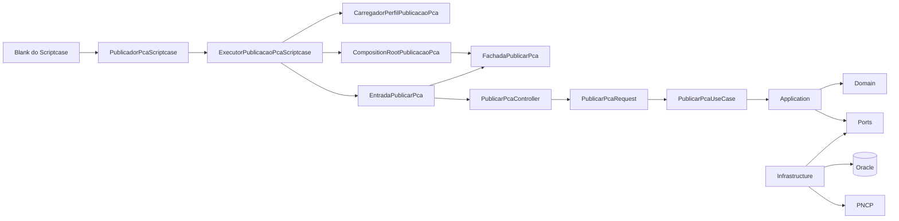
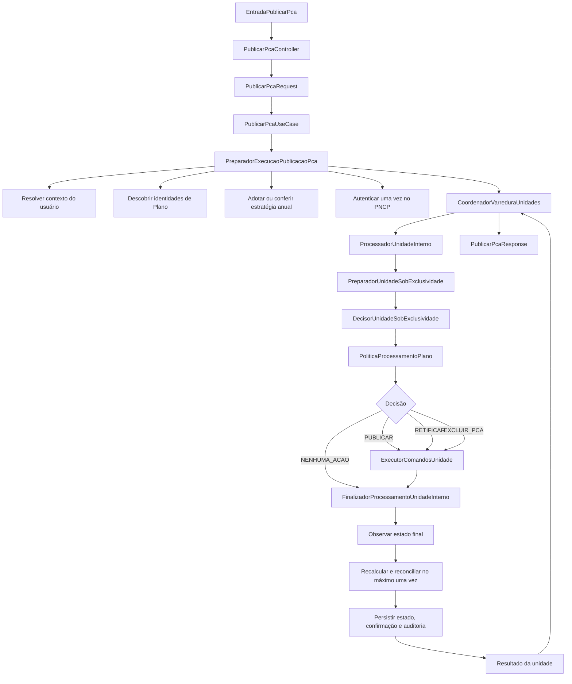
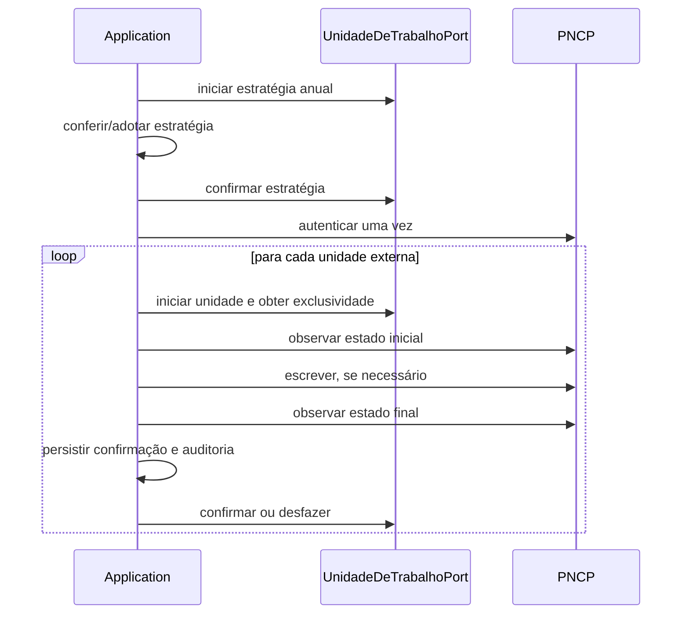

# Guia de leitura do código PCA/PNCP

**Classificação documental:** Apoio  
**Status:** Vigente  
**Autoridade/Escopo:** navegação e explicação do código sem criar regras novas

## 1. A ideia central

O Scriptcase fornece conexão emprestada, login, `SERVER_NAME`, exercício e
`X-Request-ID`. O backend seleciona externamente um perfil autorizado, obtém
dele o CNPJ e monta um grafo novo para descobrir os Planos homologados, formar
as unidades externas e levar a fotografia ao PNCP. O Domain decide **o que**
fazer; a Application coordena **quando** consultar, escrever, confirmar ou
desfazer; a Infrastructure concreta executa **como** falar com Oracle e PNCP.

Os adapters concretos das Sprints 5.2 a 5.8 implementam todas as Ports
vigentes. A Sprint 5.9 comprovou os contratos Oracle e PNCP reais, a Sprint
5.10 encerrou a Fase 5, e as Sprints 6.1 e 6.2 montaram e exercitaram o núcleo
com adapters concretos sobre fronteiras controladas. A Sprint 6.3 encerrou o
gate do núcleo, e a Sprint 7.1 adicionou a entrada tipada e o Controller sem
acesso a adapters ou wiring. A Sprint 8.1 adicionou o entrypoint público, o
registro externo e o Composition Root final e os provou transversalmente sem
acessar recursos reais. A Sprint 8.2 comprovou no Scriptcase real que esse Root
usa a receita única dos seis adapters Oracle, todos sobre a mesma conexão
emprestada, sem executar PNCP durante a montagem.

## 2. O fluxo completo

### 2.1 Preparação global

`PreparadorExecucaoPublicacaoPca` resolve o usuário, lista somente identidades,
abre uma transação curta para congelar a estratégia anual, forma unidades
individuais ou uma unidade consolidada e autentica uma única vez. Nenhuma
fotografia completa é reconstruída nessa etapa.

### 2.2 Processamento de cada unidade

`PreparadorUnidadeSobExclusividade` abre a transação da unidade, obtém o lock,
relê identidades, reconstrói Planos e consulta o estado operacional. O
`DecisorUnidadeSobExclusividade` observa o PNCP e entrega os fatos à política
pura do Domain. `ExecutorComandosUnidade` apenas traduz a decisão para comandos
tipados. O finalizador comprova o resultado antes de confirmar dados locais.

## 3. As quatro decisões

| Decisão | Quando ocorre | Escrita externa |
| --- | --- | --- |
| `PUBLICAR` | Existe fotografia desejada e não existe PCA ativo conhecido. | Cria o PCA com a fotografia completa. |
| `RETIFICAR` | O PCA ativo difere da fotografia desejada. | Exclui itens, inclui itens e observa, nessa ordem. |
| `EXCLUIR_PCA` | A fotografia ficou vazia e existe PCA ativo. | Exclui integralmente com a justificativa institucional fixa. |
| `NENHUMA_ACAO` | O estado já converge ou ambos os lados estão vazios. | Nenhuma; apenas conclui a unidade localmente. |

O limite de 1000 protege a fotografia desejada. Uma retificação de 1000 para
1000 é válida porque exclui antes de incluir; uma fotografia resultante com
1001 itens é bloqueada antes de qualquer escrita.

## 4. As duas transações

A transação anual termina antes do PNCP. A transação de uma unidade permanece
aberta durante leitura e escrita externas para preservar exclusividade local.
Qualquer caminho iniciado deve terminar em commit ou rollback.

## 5. Como entender Ports, Results e Enums

- **Port** é uma capacidade que a Application precisa, sem escolher tecnologia.
- **Command** é uma ordem tipada enviada a uma Port de escrita.
- **Result** representa todos os desfechos conhecidos de uma colaboração.
- **Enum** nomeia os estados válidos usados por esses Results.
- **Contexto** transporta fatos já comprovados entre estágios do fluxo.

Não memorize cada classe isoladamente. Leia os pares por capacidade: Port,
Result e Enum de autenticação; depois os de observação; depois escrita; depois
persistência.

## 6. Ports e adapters

| Port | Capacidade | Implementação concreta atual |
| --- | --- | --- |
| `ContextoUsuarioPort` | Resolver Representante e Lotação. | `OracleContextoUsuarioAdapter`. |
| `PlanoRepository` | Descobrir e reconstruir o Aggregate Plano. | `OraclePlanoRepository`. |
| `EstrategiaPublicacaoPort` | Consultar e congelar a estratégia anual. | `OracleEstrategiaPublicacaoAdapter`. |
| `UnidadeDeTrabalhoPort` | Transação e exclusividade. | `OracleUnidadeDeTrabalhoAdapter` sobre ADOdb emprestado. |
| `AutenticadorPncpPort` | Obter sessão opaca. | `AutenticadorPncpAdapter`. |
| `LeitorPncpPort` | Observar PCA e localizar candidatos. | `LeitorPncpAdapter`. |
| `EscritorPncpPort` | Publicar, inserir e excluir. | `EscritorPncpAdapter`. |
| `EstadoOperacionalPublicacaoPort` | Ler e persistir projeção operacional. | `OracleEstadoOperacionalPublicacaoAdapter`. |
| `RegistroAuditoriaPort` | Persistir fato confirmado. | `OracleRegistroAuditoriaAdapter`. |
| `LoggerInterface` | Diagnóstico técnico. | `AcumuladorEventosTecnicos` em memória. |

`PlanoRepository` é uma Port especializada no Aggregate `Plano`.
`OraclePlanoRepository` é sua implementação concreta e, portanto, também
exerce o papel arquitetural de Adapter sem precisar acumular esse sufixo.
Nesse adapter, `MapeamentoPlanosOracle` declara e valida tabela e colunas
físicas usadas na SQL, enquanto `MapeadorDadosPlanoOracle` traduz as linhas já
projetadas por aliases canônicos para objetos do Domain.

Para compreender por que a Port pertence ao núcleo, o adapter depende dela e o
mapeamento físico permanece na Infrastructure, leia a explicação sobre
[inversão de dependência e configuração externa](arquitetura.md#74-inversão-de-dependência-no-repositório).

## 7. Ordem prática de leitura

1. `PublicadorPcaScriptcase`, que mostra as operações públicas de publicação e
   a delegação para a Composition.
2. `ExecutorPublicacaoPcaScriptcase` e `CarregadorPerfilPublicacaoPca`, que
   validam a correlação, selecionam o registro allowlisted e constroem a entrada
   com o CNPJ do perfil.
3. `CompositionRootPublicacaoPca` e `PerfilPublicacaoPca`, que validam a
   configuração e montam os recursos concretos sem conhecer `SERVER_NAME` ou
   arquivos.
4. `FachadaPublicarPca`, `EntradaPublicarPca` e `PublicarPcaController`, que
   protegem a fronteira e adaptam a entrada.
5. `PublicarPcaPresenter`, `PublicarPcaViewModel` e
   `ResultadoUnidadeViewModel`, que projetam a saída segura sem renderizá-la.
6. `MontadorNucleoPublicacaoPca`, que explicita a topologia do núcleo.
7. `PublicarPcaUseCase` e este diagrama.
8. `PreparadorExecucaoPublicacaoPca` e `CoordenadorVarreduraUnidades`.
9. `ProcessadorUnidadeInterno`, que mostra a cadeia de três estágios.
10. `PreparadorUnidadeSobExclusividade`.
11. `DecisorUnidadeSobExclusividade` e `PoliticaProcessamentoPlano`.
12. `ExecutorComandosUnidade`.
13. `FinalizadorProcessamentoUnidadeInterno`, lido como quatro blocos: observar,
    recalcular, persistir e concluir.
14. Results e Enums somente quando aparecerem no caminho estudado.
15. `FluxoConcretoApplicationTest`, que executa o grafo montado sem Infrastructure.
16. `MontadorNucleoPublicacaoPcaIntegrationTest`, que executa o mesmo ponto de
    montagem com os nove adapters concretos sobre ADOdb, cURL e tempo
    controlados.
17. `PublicadorPcaScriptcaseIntegrationTest`, que atravessa a fronteira pública
    até a Application e encerra localmente antes de qualquer rede real.

O [catálogo de arquivos](catalogo_de_arquivos.md) responde onde cada conceito
está e evita procurar pelo repositório inteiro.

## 8. Explicação em cinco minutos

> O PCA homologado no SGI é a fonte da fotografia desejada. A Application
> congela a estratégia anual, autentica no PNCP e processa cada unidade sob um
> lock local. O PNCP é observado, a política do Domain escolhe publicar,
> retificar, excluir ou não agir, e a Application executa essa intenção. Uma
> resposta HTTP nunca basta: o estado externo é observado novamente. Somente a
> convergência permite confirmar as versões locais, registrar auditoria e dar
> commit. Falhas conhecidas viram resultados seguros; falhas sistêmicas
> interrompem sem fabricar resultados para unidades não visitadas.

## 9. Estado da implementação

O fluxo descrito neste guia está implementado. O caminho de publicação começa
em `PublicadorPcaScriptcase`, passa pelo executor, pelo Composition Root, pela
Presentation, Application e Domain e alcança os adapters concretos de Oracle,
PNCP e observabilidade.

A aplicação Blank chama somente as fachadas públicas, entrega ao navegador um
resultado seguro e registra os eventos técnicos depois do encerramento da
transação de negócio. O `RegistradorEventosTecnicosScriptcase` persiste o JSON
integral em CLOB usando a conexão ADOdb emprestada e uma transação técnica
separada por evento.

O backend é distribuído em pacote autocontido, com manifesto de integridade, e
foi instalado junto à aplicação hospedeira. Probes e gates históricos continuam
separados do fluxo de produção e não substituem suas fachadas públicas.

O progresso da implementação e suas evidências pertencem ao
[estado do trabalho dos agentes](../../../.agents/planejamento/estado_atual.md).
A condição do produto instalado e as restrições correntes pertencem à
[situação operacional](../operacional/situacao_operacional.md), não a este guia
de leitura.
