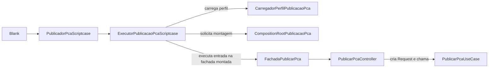
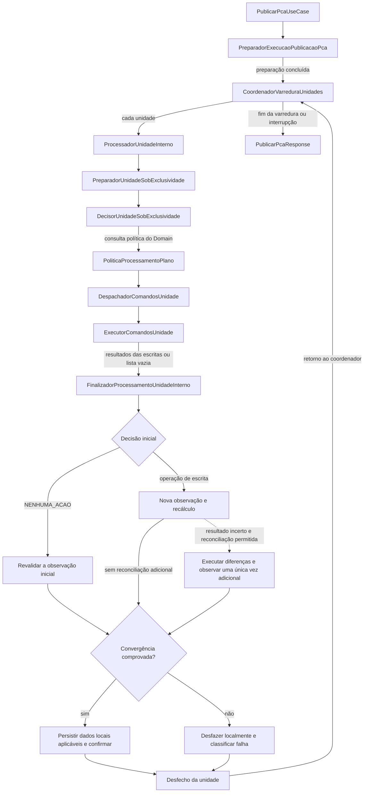
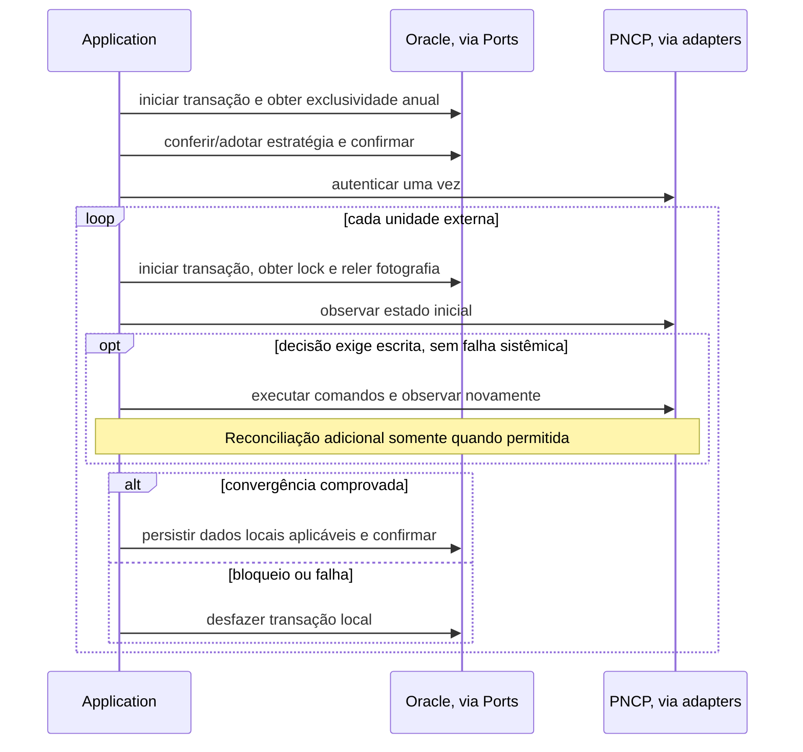

# Guia do fluxo da aplicação PCA/PNCP

**Classificação documental:** Apoio  
**Status:** Vigente  
**Autoridade/Escopo:** explicação do fluxo pelo código, sem criar regras novas

## Explicação em 1 minuto

> Os Planos homologados no SGI fornecem a fotografia desejada: as Demandas que
> devem estar no PNCP. A Application congela a estratégia anual, autentica uma
> vez e processa cada unidade sob um lock local, que impede execuções locais
> simultâneas sobre ela. A política do Domain decide publicar, retificar,
> excluir ou não agir. Depois de uma escrita, o PNCP é observado novamente:
> aceitar uma requisição não comprova que os conjuntos convergiram. A
> convergência permite confirmar as versões locais e, quando cabível, registrar
> auditoria, concluindo com commit. Falhas viram resultados seguros; falhas
> sistêmicas interrompem sem fabricar resultados para unidades não visitadas.

## 1. Da Blank ao caso de uso

A Blank fornece conexão emprestada com o banco de dados, login, `SERVER_NAME`, ano exercício de publicação e
correlationID. O executor valida a correlação, carrega o perfil autorizado e
obtém dele o CNPJ. O Composition Root monta os objetos e conecta suas
dependências para a chamada; montar esses objetos ainda não executa o caso de uso.

As camadas Presentation adapta entrada e saída; Application coordena o fluxo; Domain
protege as regras e decide; Infrastructure executa Oracle e HTTP/PNCP.
Essas responsabilidades seguem a [arquitetura](arquitetura.md).

## 2. O fluxo completo

As setas abaixo mostram a sequência das etapas principais. Falhas podem
encerrar uma etapa antes da seguinte; os objetos de dados não fazem chamadas.

O **preparador global** resolve o contexto do usuário, descobre identidades de
Plano, adota ou confere a estratégia anual, forma as unidades e autentica.
No **modo individual** há uma unidade por UO; no **consolidado**, uma unidade reúne
os Planos de todas as UOs, sem fundi-los em um único Plano.

Sob exclusividade, o preparador da unidade relê identidades, reconstrói a
fotografia vigente e consulta o estado operacional local. O decisor observa
o PNCP e consulta a política. O despachador chama o executor de comandos e,
com seus resultados, o finalizador. A persistência local reúne estado
operacional, confirmação das versões pendentes e auditoria cabível.

## 3. As quatro decisões

| Decisão | Situação, após validar a coerência dos fatos | Escrita externa |
| --- | --- | --- |
| `PUBLICAR` | Há Demandas desejadas e o PCA está ausente. | Cria o PCA completo. |
| `RETIFICAR` | Há PCA ativo e diferenças nas identidades dos itens. | Exclui itens antes de incluir, conforme as diferenças. |
| `EXCLUIR_PCA` | A unidade ficou sem Demandas e há PCA ativo. | Exclui o PCA com a justificativa institucional fixa. |
| `NENHUMA_ACAO` | Os conjuntos coincidem ou ambos estão vazios/inativos. | Nenhuma; pode confirmar versões locais pendentes, sem auditoria de negócio. |

A comparação é por **pertencimento**: quais identidades de Demandas estão
presentes. Ela não compara os atributos de cada item (`RN-PUB-006`, `DI-001`).
O limite de 1000 vale para a fotografia desejada; 1001 itens bloqueiam a escrita.

Exemplo: o SGI deseja os itens `{10, 30}` e o PNCP possui `{10, 20}`.
`RETIFICAR` exclui `20` e inclui `30`. Após as escritas aceitas, a nova
observação encontra `{10, 30}` e o recálculo devolve `NENHUMA_ACAO`.
Isso comprova a convergência; a operação apresentada continua sendo `RETIFICAR`.

## 4. As duas transações

São duas fronteiras de negócio: uma transação curta para a estratégia anual
e outra para cada unidade externa. A segunda mantém o lock durante o acesso ao PNCP.

**Commit** confirma as alterações Oracle; **rollback** desfaz as alterações
locais ainda não confirmadas. Rollback não desfaz uma escrita já realizada no
PNCP. Se o PNCP convergir e a persistência local falhar, a próxima atuação
precisa considerar os dois estados, conforme `DI-004` e `DI-008`.

## 5. Contratos e objetos no caminho

- **Port:** contrato interno de uma capacidade; **Adapter:** sua implementação concreta.
  A chamada a `LeitorPncpPort` já é atendida pelo `LeitorPncpAdapter` injetado.
- **Command:** dados de uma ordem; o adapter os transforma em requisição externa.
- **Result:** desfecho tipado; **Enum:** conjunto de estados nomeados desse desfecho.
- **Contexto:** fatos reunidos para a próxima etapa, como Planos e estado observado.

`PlanoRepository` é uma Port do Domain para reconstruir e confirmar Planos;
`OraclePlanoRepository` a implementa e traduz os dados físicos. Consulte o
[glossário](glossario.md) conforme os termos aparecerem na leitura.

## 6. O retorno e os caminhos de falha

O coordenador reúne os resultados unitários; o UseCase produz a **Response**,
resposta da Application. O Presenter a converte em **ViewModel**, dados seguros para apresentação.
Fachada e executor devolvem esse resultado à Blank, que o serializa em JSON.
`executarComEventos` também entrega os eventos técnicos acumulados em memória.
A Blank solicita seu registro somente após o encerramento transacional,
por uma fachada própria, com uma transação técnica por evento.

No modo individual, `BLOQUEADO` ou `FALHA_RECONCILIAVEL` de uma unidade permite
continuar nas demais. Falha sistêmica interrompe a varredura, preservando os
resultados já obtidos. Uma escrita incerta exige observar e recalcular antes
de qualquer reconciliação; não é autorização para repetir o comando às cegas.
Falhas e tentativas ficam nos eventos técnicos; auditoria de negócio registra
operações externas confirmadas, conforme `RN-AUD-001` e `DI-006`.

## 7. Ordem prática de leitura

Siga uma execução; abra Results e Enums quando aparecerem, sem tentar memorizar todas as classes.

1. [Blank: onExecute](../../../integracao/scriptcase/PCA_PUBLICAR_B/onExecute.php) e [PublicadorPcaScriptcase](../../../src/PublicadorPcaScriptcase.php): chamada pública e resposta HTTP.
2. [ExecutorPublicacaoPcaScriptcase](../../../src/Composition/ExecutorPublicacaoPcaScriptcase.php): correlação, perfil, entrada e execução da fachada.
3. [CompositionRootPublicacaoPca](../../../src/Composition/CompositionRootPublicacaoPca.php) e [MontadorNucleoPublicacaoPca](../../../src/Composition/MontadorNucleoPublicacaoPca.php): montagem dos adapters e dos colaboradores internos.
4. [FachadaPublicarPca](../../../src/Presentation/Facades/FachadaPublicarPca.php) e [PublicarPcaController](../../../src/Presentation/Controllers/PublicarPcaController.php): proteção da fronteira e criação do Request.
5. [PublicarPcaUseCase](../../../src/Application/UseCases/PublicarPca/PublicarPcaUseCase.php): preparação global, varredura e composição da Response.
6. [ProcessadorUnidadeInterno](../../../src/Application/UseCases/PublicarPca/ProcessadorUnidadeInterno.php): siga preparador, decisor e despachador; no decisor, abra [PoliticaProcessamentoPlano](../../../src/Domain/Policies/PoliticaProcessamentoPlano.php).
7. [DespachadorComandosUnidade](../../../src/Application/UseCases/PublicarPca/DespachadorComandosUnidade.php) e [ExecutorComandosUnidade](../../../src/Application/UseCases/PublicarPca/ExecutorComandosUnidade.php): envio dos comandos e encaminhamento ao finalizador.
8. [FinalizadorProcessamentoUnidadeInterno](../../../src/Application/UseCases/PublicarPca/FinalizadorProcessamentoUnidadeInterno.php): observar, recalcular, persistir e concluir; contraste com o caminho sem escrita.
9. [PublicarPcaPresenter](../../../src/Presentation/Presenters/PublicarPcaPresenter.php): transformação da Response em ViewModel; depois, volte ao executor e à Blank para acompanhar eventos e JSON.

Para ver o fluxo em testes, leia [FluxoConcretoApplicationTest](../../../tests/Application/UseCases/PublicarPca/FluxoConcretoApplicationTest.php),
depois [MontadorNucleoPublicacaoPcaIntegrationTest](../../../tests/Integration/Composition/MontadorNucleoPublicacaoPcaIntegrationTest.php)
e [PublicadorPcaScriptcaseIntegrationTest](../../../tests/Integration/PublicadorPcaScriptcaseIntegrationTest.php).
Eles exercitam o núcleo, os adapters em fronteiras controladas e a entrada pública, sem serviços reais.

O [catálogo de arquivos](catalogo_de_arquivos.md) localiza os demais componentes.
As regras e decisões pertencem às fontes indicadas pelo
[fluxo autoritativo](../autoritativos/fluxo_de_implementacao.md).
Antes de qualquer execução real, consulte a [situação operacional](../operacional/situacao_operacional.md).

Se precisar de ajuda para acompanhar as chamadas e os retornos, leia o
[fluxo feliz de retificação de ponta a ponta](../../historico/didatico/fluxo_feliz_retificar_de_ponta_a_ponta.md).
É um apoio didático histórico; confira seus detalhes com o código e a documentação vigentes.
